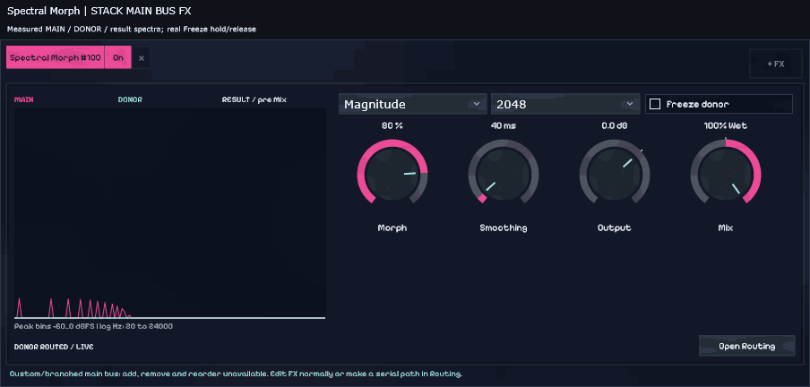
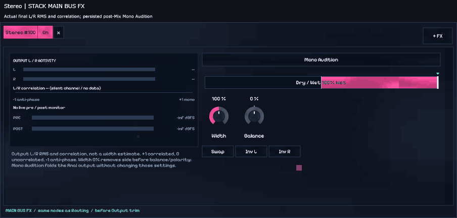

# HEAVEN by lil grass block

**Build a vocal stack. Split it into parallel effects. Or run just the delay.**

HEAVEN is an open-source audio effect for **Windows x64 · CLAP and VST3**. Turn one take into **up to eight generated voices plus an independent Lead**, shape each branch, and bring it all back together in a modular effects graph. Stack and Routing are two views of the same patch.

[Download the latest release](https://github.com/YukiYuziriha/plug1/releases/latest) · [Install](#download--install) · [Getting Started](docs/Getting-Started.md) · [Showcase](#showcase)

## v1.13.4 — Less CPU when you just want an effect

**53.5–59.4% less audio-thread CPU than v1.13.3** in a single stereo Delay patch with the vocal modules off. The patch reported **0 samples of latency** and matched the latency-aligned impulse response. Measured offline in Windows CLAP at **44.1, 48 and 96 kHz**, with **64- and 512-frame blocks** and **five paired runs per configuration**. State recall from released v1.13.3 was also verified offline.

Disabled vocal modules and rack FX stop processing without losing their settings or wiring. When a patch changes the required latency, HEAVEN requests automatic reactivation in CLAP and VST3; the host decides when to apply it.

## What you can make

- **Doubles and layered harmonies.** Shape pitch, fine detune, formant, gain, pan, delay and motion per generated voice, with independent Lead edits. Start clean or pick from [30 factory presets](docs/Factory-Presets.md).
- **Parallel and multiband effects.** Give voices their own FX, split signals into two or three bands, and recombine branches with Dry/Wet mixers. Main Bus FX tabs edit the same nodes as Routing.
- **Spectral crossbreeds.** Blend a donor’s spectrum into your vocal with Spectral Morph’s **MAIN** and **DONOR** inputs, Magnitude and Envelope modes, and donor Freeze. Feed it an internal branch or a mono/stereo host sidechain.
- **Glitch fills and grain echoes.** Grab a phrase and fire reverses or ratchets with Vocal Glitch, including MIDI triggering. Give Granular its own Delay on the wet path so the echoes follow Granular’s Mix.
- **Tone, space and movement.** EQ8, Waveshaper, Chorale, Delay, Reverb, synthetic-IR Convolution, Saturator, Compressor, Bitcrusher, Granular, Gain, Stereo, Gate/Expander, XP Filter and Synth Filter. Animate patches with LFO or Random modulation, save full-patch presets, and switch between Device, Neon and Spectral themes. Routing has Undo/Redo, and input/output meters show RMS and sample peaks.

## Showcase

*Earlier Neon captures showing effect controls and signal displays.*

### Spectral Morph — borrow and freeze a spectrum

### Reverb — see the wet tail

### Compressor — see the gain reduction actually applied

### Stereo — check width and mono compatibility

## Download & install

Get the **Windows x64 ZIP**, **SHA256 checksums**, and **corresponding source** from the [latest GitHub release](https://github.com/YukiYuziriha/plug1/releases/latest). Extract the ZIP and install just the format your host supports:

| Format | What to copy | Install location |
| --- | --- | --- |
| CLAP | `HEAVEN by lil grass block.clap` | `%LOCALAPPDATA%\Programs\Common\CLAP\` or `C:\Program Files\Common Files\CLAP\` |
| VST3 | The **entire** `HEAVEN by lil grass block.vst3` folder, including `Contents` | `%LOCALAPPDATA%\Programs\Common\VST3\` or `C:\Program Files\Common Files\VST3\` |

Close hosts that have HEAVEN loaded before replacing it. Add the install location to your host’s scan paths if needed, rescan, and insert **HEAVEN by lil grass block** as an audio effect. Keep the included license files, source notice, font license and third-party notices with your copy. No macOS, Linux or standalone binaries are supplied.

## First patch

1. Insert HEAVEN on a vocal track. Turn on **Doubler**, dial in **Human** and **Width**, then balance the Lead against the generated voices with **Lead / Stack**.
2. Select a voice card to edit it, or use **+ Add voice** to expand the stack.
3. Use **+ FX** for main-bus effects, or open **Routing** to build per-voice, multiband or sidechain paths.
4. Set **Global Mix** to blend the original input with the whole patch, trim **Output**, and save a preset.

[Getting Started](docs/Getting-Started.md) · [Build from source](docs/Building.md) · [Report an issue](https://github.com/YukiYuziriha/plug1/issues)

## License & credits

Open source under **GPLv3 + AGPLv3**: project-owned code retains [GPLv3](LICENSE), with JUCE used under its [AGPLv3](COPYING.AGPLv3) option. See [licensing and corresponding source](docs/Licensing.md) for combined-work and redistribution terms, and [historical source downloads](docs/Historical-Source.md) for older releases.

[Third-party notices](ThirdParty) cover JUCE, CLAP/CLAP JUCE Extensions, the VST3 SDK, Signalsmith Stretch/Linear, the GPL-covered [Vital filter subset](ThirdParty/Vital/README.md), and Pixelify Sans under the [SIL Open Font License 1.1](ThirdParty/PixelifySans-OFL.txt). Embedded dependency notices also apply. Convolution uses original synthetic Church, Hall, Room and Plate IRs.
