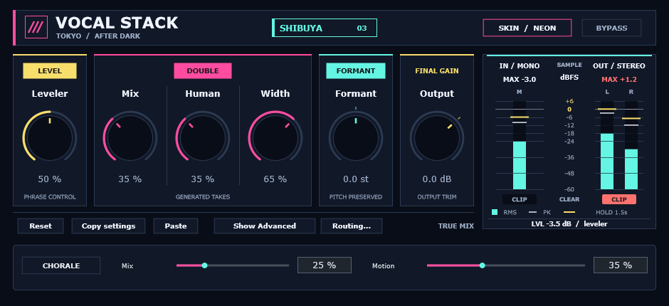

# Vocal Stack 1.3.0

Windows x64 audio effect for Bitwig Studio. The archive contains a CLAP plugin,
a VST3 fallback, and C++ source with CMake and tests.

## Install

1. Extract the ZIP.
2. Copy `Windows-x64/CLAP/Vocal Stack.clap` to
   `C:\Program Files\Common Files\CLAP\`. The per-user location is
   `%LOCALAPPDATA%\Programs\Common\CLAP\`.
3. Open Bitwig and search for **Vocal Stack** in the audio effects browser.
   Check **Settings → Locations → Plug-in Locations** if your chosen location is
   missing.
4. To use VST3, copy the entire `Vocal Stack.vst3` folder from
   `Windows-x64/VST3/` into `C:\Program Files\Common Files\VST3\`.

Installation paths are defined by [CLAP](https://github.com/free-audio/clap/blob/main/include/clap/entry.h)
and [VST3](https://steinbergmedia.github.io/vst3_dev_portal/pages/Technical%2BDocumentation/Locations%2BFormat/Plugin%2BLocations.html).

## Controls

| Control | Default | Effect |
| --- | --- | --- |
| Leveler | 50% | Smooth phrase dynamics while approximately preserving long-term input RMS; 0% off |
| Mix | 35% | True dry/wet doubler blend: 0% processed lead, 100% generated voices only |
| Human | 35% | Variation in the doubles' timing, pitch, and tone |
| Width | 65% | Stereo spread of the doubles |
| Formant | 0.0 st | Moves vocal resonances at the original lead pitch |
| Output | 0.0 dB | Final output trim, −24 to +12 dB; double-click for unity |

Bitwig's **Plug-in Parameters** button exposes all 139 parameters, including eight
voices, musical Pitch, presence, and 16 fixed Chorale automation slots. The original **Vocal Stack**
CLAP Remote Controls page retains its five knobs and three module switches. A
second **Output** page supplies output trim and bypass. Original parameter IDs,
indices and remote assignments are unchanged; new parameters are appended.
Older sessions default Advanced and Chorale to off and Output to 0 dB when absent.

Click **SKIN / DEVICE** or **SKIN / NEON** to switch the editor. Neon uses a
flat Shibuya-at-night palette. The project
state stores the skin, controls, and bypass switches. **Reset** restores the
audio controls. **Copy settings** and **Paste** transfer settings between
instances. Full bypass uses the latency-aligned dry signal, ignoring output trim.
Output trim is smoothed over 18 ms and is not a limiter.

### Metering

The dedicated meter panel displays actual input and final output in **dBFS**:

- Independent L/R lanes for stereo, one M lane for mono.
- **RMS** fill: unweighted power with a 300 ms averaging time constant. A
  full-scale sine reads approximately −3.01 dBFS RMS, not 0 VU or LUFS.
- White **PK** markers: fast sample-peak envelope, falling at 24 dB/s.
- Amber **HOLD** markers: 1.5-second peak hold, then 12 dB/s decay.
- **MAX**: highest sample peak across the active channels since clear.
- Red **CLIP**: latched when a sample reaches or exceeds 0 dBFS. This indicates
  sample overload, not true/intersample peak; it does not clip or limit the audio.
- **LVL**: separately labeled leveler gain correction, not output trim.

Click the panel to clear held/max peaks and clip flags without changing the
audio, RMS, or live peak envelope. Space/Return are not meter shortcuts. Audio must be
processing for the reset request to take effect; ongoing overload relatches CLIP.
Meters keep their history independently of the editor's 30 Hz refresh.



The preview uses synthetic readings to demonstrate peak hold and clip indication.

### Mix and Leveler

**Mix is now a true linear dry/wet crossfade for the doubler.** Dry means the lead
after Leveler and shared Formant processing, not a whole-plugin bypass. At 100%,
no lead remains; with all advanced voices disabled the wet bus is silent. Turning
DOUBLE off restores the processed lead regardless of Mix. Chorale and Output
remain downstream. A linear blend of decorrelated voices can dip in RMS near the
middle; neither a fixed perceived loudness nor identical peaks are guaranteed.

**Leveler is not output gain.** It compares short-term phrase RMS against the
recording's own slower energy envelope instead of forcing −20 dBFS RMS. Bounded,
smoothed normalization approximately preserves long-term input RMS as strength
changes. It needs audio history to settle; attacks and individual peaks can change.
It is not a limiter or LUFS matcher. Total correction is bounded to −10/+8 dB,
with gating to avoid lifting room tone. At 0% or off it settles to exact unity.
Use Output for manual trim. Other modules can still change final output level.

### Advanced Doubler

**Show Advanced / Hide Advanced** only changes editor size, never sound. The
separate **ADVANCED DOUBLER** switch selects the saved custom stack instead of
Basic's two voices. Fresh configurations show two voice cards and **+ Add voice**.
Add up to eight generated voices (the lead is separate), in a horizontally scrollable
card area. **On** mutes without removing the card; **Remove** hides/disconnects an
added slot without renumbering the others or erasing its settings. Re-adding uses
the first absent slot and its retained settings. The first two cards cannot be
removed through the UI. Independent voice controls provide:


| Voice control | Range | Meaning |
| --- | --- | --- |
| On | Off / On | Smoothly include this generated voice |
| Gain | −60 to +12 dB | Relative voice gain, not erased by automatic normalization |
| Pan | −1 to +1 | Left to right; shared Width scales the spread |
| Delay | 0–100 ms | Base timing offset; large changes slew rather than jump |
| Pitch | −36 to +36 st | Actual musical transposition; default 0 st, fractional intervals supported |
| Fine detune | −100 to +100 ct | Separate subtle static pitch offset |
| Formant | −24 to +24 st | Independent voice resonance offset |
| Depth | 0–2× | Scale this voice's timing, pitch and formant motion |
| Rate | 0–8 Hz | Approximate irregular motion rate, not a repeating chorus LFO |

Human scales movement for all voices; it does not overwrite your stored offsets.
Human or Depth at zero removes movement while retaining fixed offsets. Rate zero
freezes the motion state. Shared Formant adds to voice offsets when enabled;
turning it off leaves Advanced's independent formants active. Basic's subtle voice
coloration still follows the shared Formant switch. Consonant suppression keeps
the generated stack behind the lead. Stereo input doubles use its mono mid;
the lead preserves the input stereo image.

First UI activation initializes voices from current Human unless you have already
edited or restored custom voices. Later toggles preserve custom edits. Host
automation of Advanced uses stored voice settings without rewriting parameters.
**Reset to Basic** restores current Human-derived two-voice settings and removes
extra cards/connections, without changing activation, Mix, Width, Leveler, Chorale
or Output. Stable routing source identities and dormant FX settings remain.
With matching settings and shared Formant enabled, Basic and Advanced produce the
same audio. Disabling Advanced uses Basic processing and retains your custom stack.

The default wet Sum compensates additional active voices relative to the original
two-voice power budget. Explicit Sum nodes use a one-source budget by default.
Source-lineage compensation also accounts for duplicated branches; intentional
Gain and Pan settings are not normalized away. This is not a loudness rider or
limiter and cannot eliminate correlation/phase-dependent loudness differences.

The main Formant knob now spans **−24 to +24 st**. Shared and independent voice
Formant add together, allowing **±48 st** before additional Human motion; there
is no ±24 combined cap. Pitch does not perform scale detection or pitch correction.
Large pitch/formant shifts are creative processing, with source-dependent artifacts.
Signed sliders fill from zero; Gain fills from its 0 dB marker, not the midpoint
of its asymmetric range.

### Voice Motion

The monitor shows measured DSP snapshots: effective pan horizontally and live fine
detune (±150 ct) vertically. Musical Pitch is shown separately in the selected
voice readout so octave intervals do not obscure fine movement. Dot numbers/colors
are stable, brightness follows measured voice activity, and trails follow actual
modulation. Click a dot to reveal its card; click a card to select its dot. The
readout includes extra delay (not algorithmic latency), effective formant and gain.
Until audio is processed, no live voice measurements are available.

### Optional FX routing

Click **Routing...** to open the independent native node canvas. Drag output pins
to input pins, drag nodes to arrange them, and drag blank space to pan. Ctrl+wheel
or the +/- buttons zoom; **Fit** frames the patch. Select a cable and press
**Disconnect**, or select a node to inspect/delete/bypass it. Toolbar **Undo/Redo**
restores graph edits; ordinary controls leave transport shortcuts to the DAW.

Available nodes: Lead, Voice sources, Chorale, Compensated Sum, Dry/Wet Mix, Output.
One Chorale node is one independent machine; routing chooses whether it processes
one voice, a group, or the whole result. Use explicit Sum nodes for multiple inputs;
Mix has separate Dry and Wet pins. The default path is:

```text
Lead ---------------------> Main Mix Dry
Voices -> Compensated Sum -> Main Mix Wet
Main Mix -> Chorale -> Output trim / meters
```

The main Mix knob controls the main Mix node; other Mix nodes have local blends.
DOUBLE off selects the dry input of that main node, not an unconditional lead
shortcut through custom routing. A custom graph may omit it entirely. Global
bypass always returns latency-aligned original input, ignoring graph and trim.

At most 16 Chorale instances are supported: the original main slot plus 15 fixed
additional automation slots. FX inspector controls are host parameters; topology
and positions are saved separately, not automated. An incomplete/invalid sketch
is retained visibly, with a diagnostic, while the **last valid graph keeps playing**.
Reconnect required inputs to apply it. Cycles, occupied input pins, invalid links,
and unsupported additional branch latency are rejected. Per-voice Delay is intentional
timing, not latency to be compensated away.

Graph plans are validated/prepared off audio and handed off lock-free. Unchanged
FX identities retain their history. A 10 ms output-offset ramp de-clicks topology
splices without running shared processors twice; this is not a spectral old/new
crossfade. Node limits are 48 nodes and 128 links. Reusing a deleted FX automation
slot intentionally reuses its host automation identity.

EQ, multiband, XP-style Filter and waveshaper are **not included in 1.3.0**; see
[the staged plan](plan.md) for those follow-ups.

### Chorale

An independent three-tap stereo chorus follows the doubler and precedes Output and
global bypass in the default graph; routing can place instances elsewhere. **CHORALE** enables it (default off), **Mix** blends the delayed
ensemble with the incoming stack, and **Motion** increases coordinated modulation
depth and speed. This is deliberately smoother/more synthetic than Human's
independent irregular drift. It has no feedback or extra reported dry-path latency.
Controls and switching are smoothed; delay history stays warm while disabled.
Wet level and peaks vary with material (coherent taps can add up to about +3.5 dB);
leave headroom and use the output meters. Inspiration is coordinated ensemble
chorus behavior, not copied proprietary DSP, assets or presets.

### 1.3.0 compatibility note

The original 46 parameter IDs and indices are preserved; new parameters append.
Existing four-voice sessions retain all four cards, including muted ones. Missing
Pitch defaults to 0 st; legacy fine-detune values remain cents. The default Basic
path is regression-tested against the pinned 1.2.0 engine, including latency.

**Formant range expansion changes normalized host-automation mapping** for main
and per-voice Formant. Raw saved semitone values are retained, but previously
recorded normalized automation may recall differently. Save important renders and
check automated Formant tracks before replacing an older version.

### 1.2.0 compatibility note

This release intentionally changes the sound of existing sessions: the original
Mix value now means a true dry/wet blend, Leveler no longer targets a fixed RMS,
and Human zero now stops random movement. Saved values and automation IDs remain
readable, but this is not a sound-identical upgrade. New Advanced/Chorale features
start disabled for older sessions. Save important old renders before upgrading.
Full bypass remains the exact latency-aligned input, unaffected by Output trim.

The plugin reports 1,344 samples of latency at 44.1 and 48 kHz, about 30.5 and
28 ms respectively. Version 1.0.0 reported 2,496 samples at those rates. Bitwig can compensate during playback. This latency is
also present when monitoring through the effect. Bypass uses the aligned dry
path. CLAP offers stereo, mono-to-stereo, and mono layouts.

## 1.1.1 transport shortcut fix

Normal control clicks no longer request keyboard focus, and the meter panel no
longer consumes Space/Return. Idle slider value labels follow the same policy
in both skins, including after a skin change. Deliberate numeric entry still
accepts typing; commit or cancel the edit to return shortcuts to the host.

## Included 1.0.3 fixes

- Human timing drift now moves the double voices' delay read positions every
  sample, removing the 64-sample jumps that caused crackle at higher settings.
  The intended pitch, timing, and tone variation remains.
- Formant processing now matches each processed voice's average power to its
  latency-aligned, post-leveler input. The lead uses stereo-linked gain. Matching
  is smoothed, bounded to approximately ±12 dB, and applied before double-voice
  delay and consonant suppression. This preserves settled RMS level, not peaks
  or exact perceived loudness; spectral changes can still sound louder/quieter.

## Build from source

From a Visual Studio 2022 Developer PowerShell with C++ desktop tools, Git,
and CMake 3.24 or newer installed:

```powershell
cd source
cmake -S . -B build -G "Visual Studio 17 2022" -A x64
cmake --build build --config Release --parallel
ctest --test-dir build -C Release --output-on-failure
```

The first configure fetches pinned dependencies. Nine test suites cover DSP,
Chorale, routing, voices, FX automation, pitch spectra, stacked formant spectra,
CLAP hosting, and editor/state. Optionally configure with
`-DVOCALSTACK_TEST_BASELINE=ON` to add a tenth comparison suite; this requires
Python and the pinned pre-routing revision in local Git history. The plugins appear under
`build/VocalStack_artefacts/Release/`. To build just the portable DSP tests,
configure with `-DVOCALSTACK_BUILD_PLUGIN=OFF`.

The code uses [JUCE](https://github.com/juce-framework/JUCE),
[CLAP JUCE Extensions](https://github.com/free-audio/clap-juce-extensions), and
[Signalsmith Stretch](https://github.com/Signalsmith-Audio/signalsmith-stretch).
The local CLAP wrapper patch adds mono layouts, marks the bypass parameter,
and rejects invalid binary XML state.

## Architecture

- `VocalEngine`: JUCE-independent signal path and smoothed controls.
- `DoublerSettings.h`: shared Basic/Advanced voice configuration contract.
- `Chorale.h`: isolated, allocation-free-in-processing chorus module.
- `HarmonyShifter.h`: fixed-latency STFT musical pitch/formant processor.
- `Routing.h`: bounded DAG model, validation, explicit mixers, independent FX
  instances, execution-plan publication and off-audio reclamation.
- `ProcessorRoutingState.h`: graph serialization and fixed FX automation mapping.
- `VoiceBridge.h` / `VoiceMonitor.h`: atomic snapshots and snapshot-only motion UI.
- `RoutingPanel.h`: native node canvas, inspectors, layout and edit history.
- `DoublerPanel.h`: dedicated voice-card editor and Chorale controls.
- `Metering.h`: reusable per-channel RMS, sample-peak and hold detectors.
- `MeterBridge.h`: lock-free, best-effort audio-to-UI display snapshots.
- `PluginProcessor`: host parameters, state compatibility and audio-thread meter
  reset requests. Stable host parameter order is separate from UI mappings.
- `PluginEditor` / `MeterPanel`: controls, skins and presentation only.

Keep future effects as small DSP modules called by the engine, rather than
putting signal processing in the editor. See `AGENTS.md` for project conventions.

## Verification

- 1.3.0 Release CLAP/VST3 built with MSVC 2026. All ten suites passed before
  the final UI/state-bridge cleanup. On the final build, the other nine suites
  passed again; the unchanged long DSP suite rerun was interrupted and not repeated.
- Packaged and installed CLAP smoke tests passed; both installed formats were
  byte-compared against the refreshed packages. Both skins and graph interactions
  have automated UI coverage. Actual listening/transport checks in Bitwig remain
  user validation.


- Version 1.1.1 Windows x64 binaries were built natively with MSVC 2026 and
  Ninja. All three CTest suites (DSP, CLAP host, editor/state) passed.
- DSP checks cover Human update boundaries at 44.1–192 kHz, formant RMS matching
  at 44.1–96 kHz, stereo/mono behavior, leveler/doubler balance, gain accuracy and
  smoothing, block-size independence, automation, silence/reset, calibrated
  meters, peak timing and latched overloads. Meter-only resets do not alter audio.
- Editor tests cover both skins' bounds and control bindings, state copy/paste,
  legacy sessions without Output, unity reset, mouse-only meter clear, and PNG
  rendering. Hidden native-peer tests check Space/Return are unconsumed outside
  numeric editing, and that numeric commit/cancel restores this behavior. Focus
  policy is checked again after switching skins. Actual DAW transport behavior
  still requires a host check. CLAP tests cover ten parameters and both remote pages.
- Earlier Linux CLAP builds passed 34 validator checks with zero failures and
  warnings. Ten inapplicable checks were skipped. The earlier Linux VST3 build
  passed pluginval at strictness level 5. These external validators have not
  been rerun for 1.1.1.
- The DSP and CLAP host tests exercised bypass alignment, three bus layouts,
  state recall, parameter automation, offline processing, and operation at
  several sample rates up to 192 kHz. The formant tests included steady 72 Hz
  and 260 Hz fundamentals with shifts in both directions. The CLAP host test
  also verified all ten automation parameters while preserving the original
  eight Remote Controls mappings.
- During version 1.0.0 testing, both editor skins rendered in a Linux CLAP
  host and Bitwig Studio 6.1.4 on Linux scanned and inserted the CLAP.
  The sandbox's Bitwig audio engine stopped during startup. Playback in
  that Linux Bitwig sandbox remained unverified. The user subsequently confirmed
  an earlier Windows build works in Bitwig. Version 1.1.1 has passed the offline
  checks above; listening to this updated version in Bitwig remains a user check.
