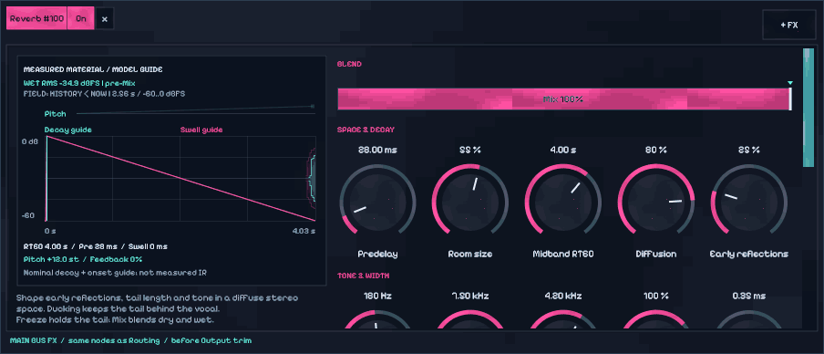
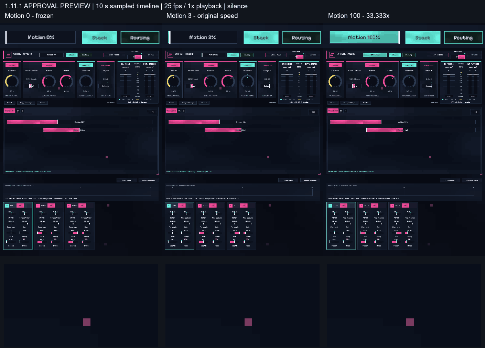

# HEAVEN by lil grass block

**Build a vocal stack. Shape each voice. Route the result your way.**

HEAVEN by lil grass block is a Windows x64 audio effect in **CLAP and VST3** formats. Start with
vocal doubling, expand to **eight generated voices plus a separate Lead**, then
shape individual branches or the whole mix with a modular effects graph. Stack
and Routing are two views of the same patch—not separate processing modes.

**v1.12.1 — automatic tuning activation** · [Download & install](#download--install) ·
[Getting Started](docs/Getting-Started.md) · [Showcase](#showcase) ·
[Build from source](docs/Building.md) · [GPLv3 + AGPLv3 licensing](docs/Licensing.md)

*The Neon theme, with Spectral Morph open in the Stack FX rack.*

Formerly **VocalStack** (displayed as **Vocal Stack**), this is a product-name
change, not a new plugin ID. Internal IDs, preset folders and state extensions
are preserved for compatibility with existing sessions and presets.

Shared automatic correction is documented in [Tuning](docs/Tuning.md). In 1.12.1,
first enable automatically requests host audio reactivation to apply tuning
latency; subsequent Off/On toggles retain the reservation. See the
[1.12.1 validation record](docs/Release-1.12.1-Validation.md) for verified checks
and the remaining actual-DAW/listening validation.

## What you can make

- **Shared automatic Tuning.** An MXTune-derived GPL-3.0-or-later detector and
  linked stereo Signalsmith shifter with envelope formant compensation feed
  aligned clean/tuned sources and per-voice Tune Mix. The themed **Tuning** tab
  has real controls for scale, notes, correction and timing. [Usage and limits](docs/Tuning.md).
- **Doubles and layered harmonies.** Control pitch, fine detune, formant, gain,
  pan, delay and motion per generated voice, with independent Lead edits.
- **A patch, not just an effects chain.** Route voices through independent FX,
  merge branches, add Dry/Wet mixers, duplicate a signal with Splitter, or divide
  it into two/three frequency bands. Stack's Main Bus FX tabs edit the same nodes
  as Routing.
- **Two-source spectral processing.** Spectral Morph has separate **MAIN** and
  **DONOR** inputs, Magnitude/Envelope modes and donor Freeze. Use an internal
  branch or an explicitly wired optional mono/stereo host sidechain as the donor.
- **Tone, space and texture.** EQ8, Waveshaper, Chorale, Delay, Reverb, synthetic-IR
  Convolution, Saturator, Compressor, Bitcrusher, Granular, Gain, Stereo,
  Gate/Expander, XP Filter and Synth Filter.
- **Movement and recall.** LFO/Random modulation, full-patch presets, shared
  routing Undo/Redo and Device, Neon and Spectral themes. Input/output meters
  distinguish RMS and sample peaks; selected FX expose measured histories or spectra.

## Showcase

### Spectral Morph — choose a donor, then hold its spectrum

Blend another signal’s spectral character into your vocal, then freeze the donor
spectrum while the main signal keeps moving. Follow MAIN, DONOR and the result
in the live spectrum display.

### Reverb — see the wet tail, not just a decay setting

Watch the input and wet tail move through a pixel field, with decay and swell
guides keeping the shape of the space in view.

### Compressor — inspect the attenuation actually applied

Follow the sound, applied gain reduction and transfer curve in one shared graph,
with the compression meter still in view.

### Stereo — check width and mono compatibility

Width, balance, channel swap and polarity controls share a rack with L/R activity,
correlation and a persisted post-Mix Mono Audition switch.

[How these audio-driven showcases were captured](docs/showcase/README.md).

### Motion — set the pace of the pixel material

Freeze the decorative texture at **0%**, keep its default slow drift at **3%**, or
push it to roughly **33× that speed at 100%**. Motion changes the material—not
your audio or the speed of measured signal displays. The comparison plays at 1×.

### Routing — make the two-source connection explicit

Feed your vocal into **MAIN** and another track into **DONOR**, or build the donor
from an internal branch. Make the connection in Routing, then shape the result
from either view. [Try the wiring walkthrough](docs/Getting-Started.md#spectral-morph-and-sidechain).

## Download & install

Version 1.12.1 binaries are tracked below. Local release archive names are
`HEAVEN-1.12.1-Windows-x64.zip` and
`HEAVEN-1.12.1-corresponding-source.zip`, in
`source/build/publication-1.12.1`. Local packages are not a published GitHub
Release; consult the [delivery record](docs/Release-1.12.1-Validation.md).

**Historical release:** download the [**v1.11.1 Windows x64 ZIP**](https://github.com/YukiYuziriha/plug1/releases/download/v1.11.1/VocalStack-1.11.1-Windows-x64.zip)
for both formats, their complete notices and source-download information.
[SHA256 checksums](https://github.com/YukiYuziriha/plug1/releases/download/v1.11.1/SHA256SUMS.txt)
are supplied with the release. The repository's tracked packages may be newer; consult
`Windows-x64/SOURCE.md` for their own provenance rather than assuming identical bytes.

| Format | Download | Install |
| --- | --- | --- |
| CLAP | `Windows-x64/CLAP/HEAVEN by lil grass block.clap` | Copy the file to `%LOCALAPPDATA%\Programs\Common\CLAP\` or `C:\Program Files\Common Files\CLAP\`. |
| VST3 | `Windows-x64/VST3/HEAVEN by lil grass block.vst3/` (complete bundle) | Copy the **entire folder**, including `Contents`, to `%LOCALAPPDATA%\Programs\Common\VST3\` or `C:\Program Files\Common Files\VST3\`. |

For VST3, download the repository with GitHub's **Code → Download ZIP** or clone
it, then take the bundle from `Windows-x64/VST3/`. Downloading only its inner binary is not a complete installation.
Keep the [GPLv3 text](Windows-x64/LICENSE.txt), [AGPLv3 text](Windows-x64/COPYING.AGPLv3),
[source notice](Windows-x64/SOURCE.md), [font license](Windows-x64/PixelifySans-OFL.txt)
and [third-party notices](Windows-x64/ThirdParty) with your copy.

**Build or modify the historical release:** download its [complete corresponding source](https://github.com/YukiYuziriha/plug1/releases/download/v1.11.1/VocalStack-1.11.1-corresponding-source.zip),
including pinned dependencies, patches and build tools. See the
[build guide](docs/Building.md), [licensing details](docs/Licensing.md) and
[historical source downloads](docs/Historical-Source.md).

Close hosts that have the plugin loaded before replacing it. Add the chosen
folder to your host's scan locations if needed, rescan, and insert **HEAVEN by lil grass block**
as an audio effect. You only need the format your host supports.
[Detailed installation and first patch](docs/Getting-Started.md).

## First patch

1. Insert **HEAVEN by lil grass block** on a vocal track. Start with **Leveler**, **Human** and
   **Width**, then balance the edited Lead against generated voices with **Lead / Stack**.
2. Select a voice card to edit it; use **+ Add voice** to expand up to eight.
   The Lead is separate. Use moderate pitch/formant offsets before trying extremes.
3. Add main-bus processing with **+ FX**. Open **Routing** for per-voice effects,
   branches, multiband paths or a Morph donor. It is the same set of FX instances.
4. Use **Global Mix** for untouched original input versus the complete processed
   patch, and **Output** to trim level. Save a full-patch preset when ready.

**Three different blends:** Lead / Stack balances the edited Lead and generated
voices; an FX Mix blends that effect's dry/wet signals; Global Mix blends the
latency-aligned original input and the entire patch.

## Platform & practical notes

- **Delivered platform:** Windows x64, CLAP and VST3. No macOS/Linux binaries,
  standalone application or other plugin formats are supplied.
- **Tuning latency:** at 48 kHz, ON-prepared Tuning adds **1344 samples**, making
  a basic patch **2688 samples** total; OFF-prepared retains the legacy **1344**.
  Enabling from OFF-prepared needs **host audio deactivation/reactivation**, not
  just transport stop/start; the UI shows a pending message. Zero Retune Speed
  does not remove detector history (about **85 ms** at 48 kHz). [Details](docs/Tuning.md).
- **Legacy latency (Tuning OFF-prepared):** without Morph, reported totals are **1344 samples at 44.1/48 kHz**
  and **2688 at 96 kHz**. A graph declaring Morph adds **4096 samples**, even if
  that node is bypassed or disconnected. Adding/removing it can show
  **RESTART PENDING**: deactivate/reactivate or reload the plugin to apply that
  topology. Merely stopping transport is not enough. Serial Morph paths exceeding
  the routing latency budget are rejected.
- **Custom routing:** unwired inputs receive silence. A branched/auxiliary patch
  can make rack add/remove/reorder unavailable; edit its topology in Routing.
  Existing FX parameters remain editable.

**Experimental status:** automated DSP and CLAP/VST3 checks cover mono/stereo
layouts and sidechains at 44.1, 48 and 96 kHz. Actual DAW listening/workflow and
native UI performance remain unverified. **Real-vocal tuning listening is
unverified; no Antares/Auto-Tune equivalence is claimed.** See the
[release validation](docs/Release-1.11.1-Validation.md) for test results, outstanding
checks and known limitations.

## Documentation & support

- [Getting Started](docs/Getting-Started.md) — installation, voices, routing,
  sidechain, latency and troubleshooting.
- [Tuning](docs/Tuning.md) — controls, shared sources, reactivation and tracking limits.
- [Building](docs/Building.md) — prerequisites, pinned dependencies, CMake and tests.
- [Manual and history archive](docs/Manual-and-History.md) — preserved detailed
  controls, architecture and earlier release records; historical values are labeled.
- [v1.11.0 technical notes](docs/Preview-1.11.0.md) and
  [release validation](docs/Release-1.11.0-Validation.md) — implementation details
  and observed limitations. References to local build artifacts in these older
  records are not public downloads.
- [Report an issue](https://github.com/YukiYuziriha/plug1/issues) with the plugin
  version, Windows/host version, format, sample rate, block size and a small
  reproduction patch. Remove private audio and personal paths before sharing.

## License & credits

Open source under **GPLv3 + AGPLv3**: project-owned code retains
[GPLv3](LICENSE), with JUCE used under its [AGPLv3](COPYING.AGPLv3) option.
[Licensing and corresponding source](docs/Licensing.md) explains the combined
work and redistribution terms; third-party components retain their own licenses.

[ThirdParty](ThirdParty) retains notices for JUCE, CLAP/CLAP JUCE Extensions, the
VST3 SDK, Signalsmith Stretch/Linear, the GPL-3.0-or-later
  [MXTune/Autotalent detector adaptation](ThirdParty/Tuning.md), the GPL-covered
[Vital filter subset](ThirdParty/Vital/README.md), and Pixelify Sans under the
[SIL Open Font License 1.1](ThirdParty/PixelifySans-OFL.txt). Embedded dependency
notices also remain applicable. Convolution uses original synthetic Church,
Hall, Room and Plate IRs, not third-party sampled spaces.
