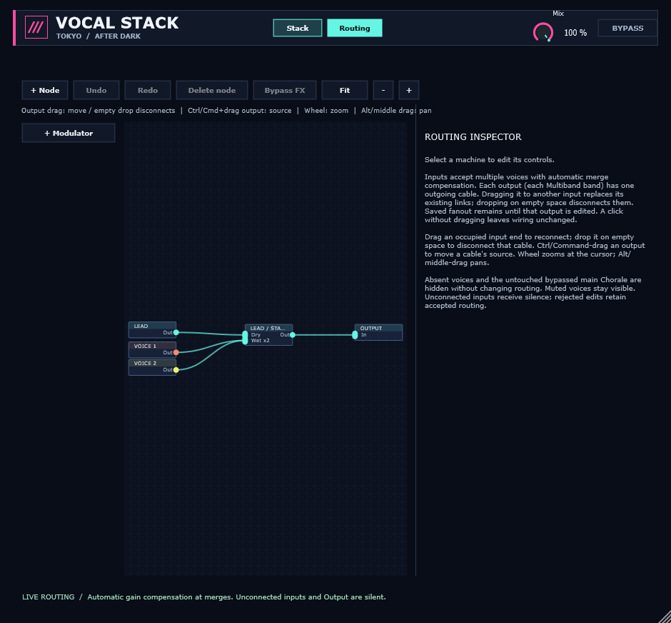
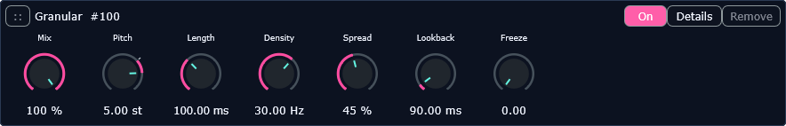
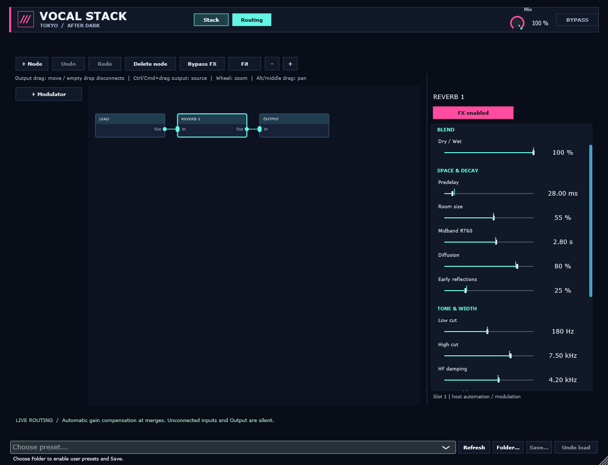
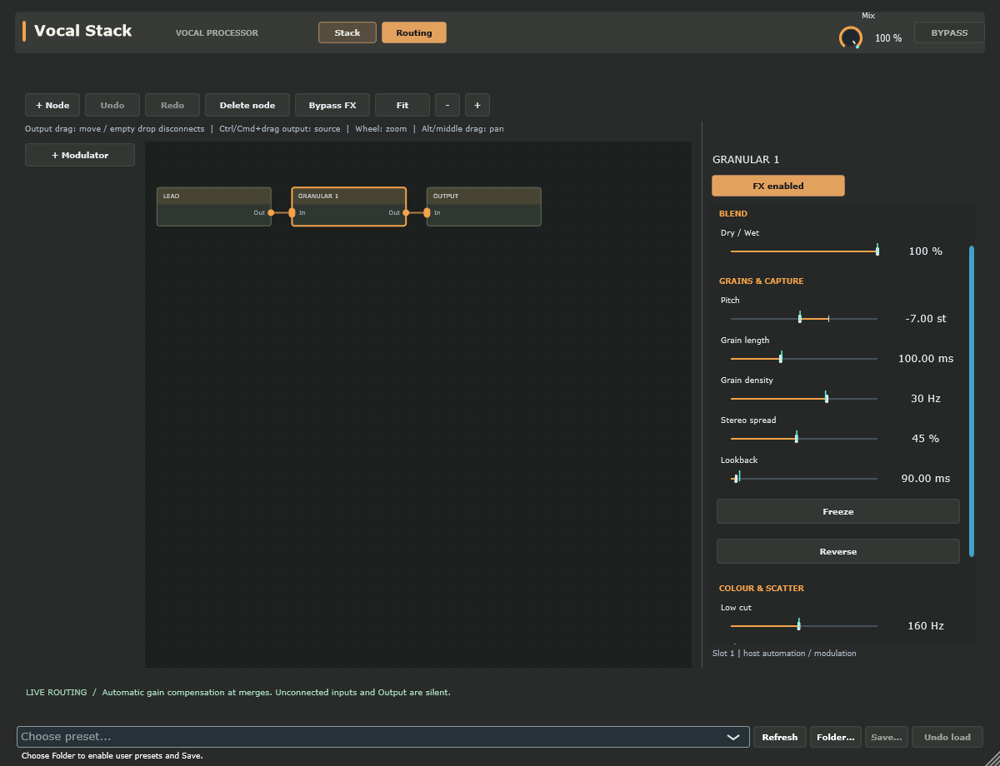
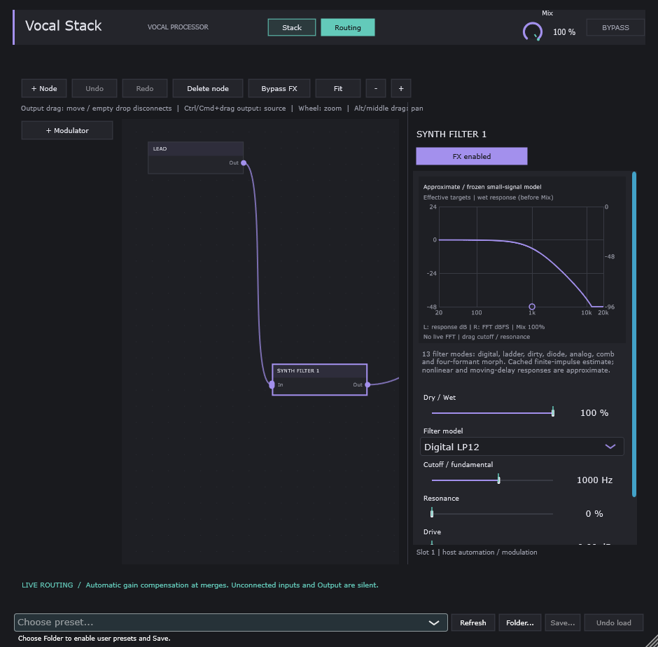
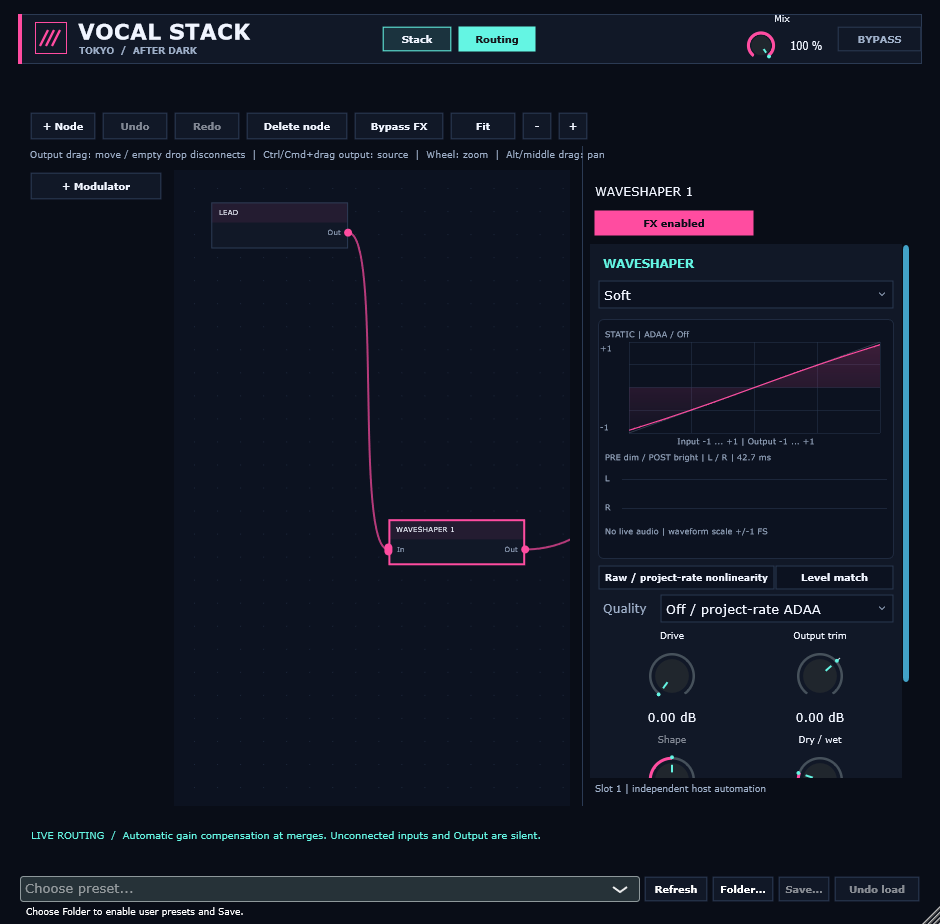
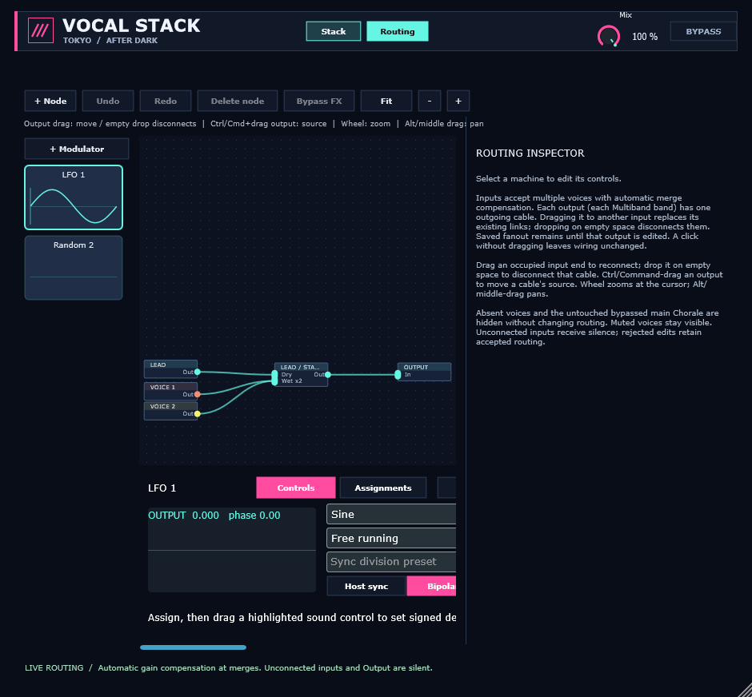
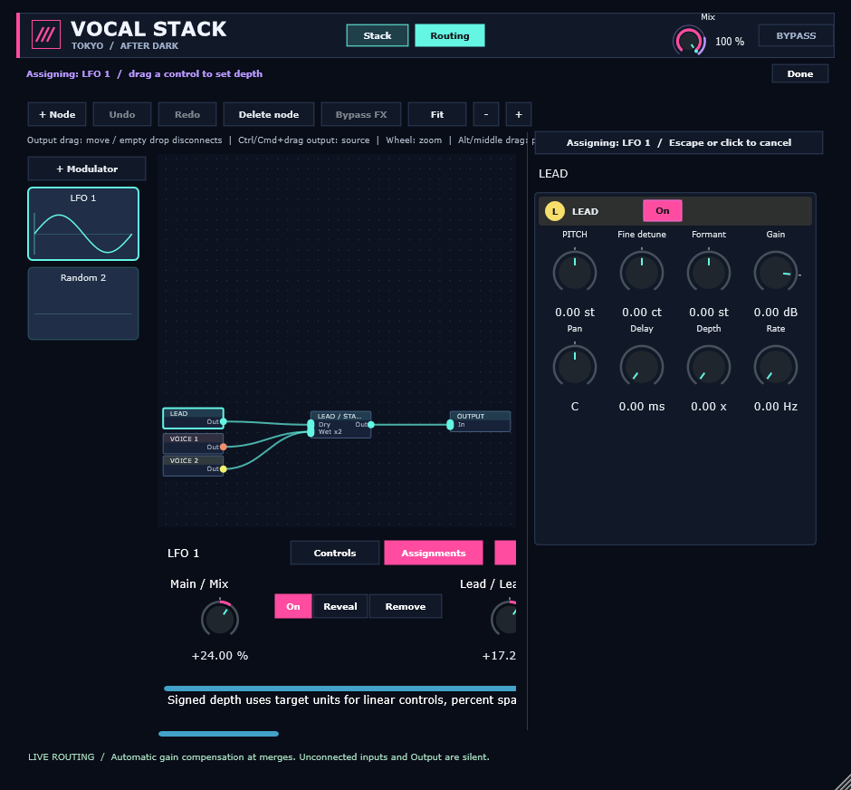
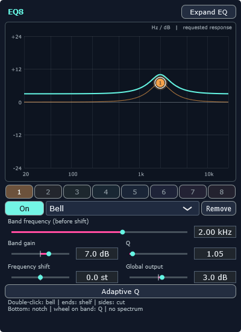

# Vocal Stack 1.9.0

Windows x64 audio effect for Bitwig Studio. The archive contains a CLAP plugin,
a VST3 fallback, and C++ source with CMake and tests.

1.9.0 is **built, packaged, validated and installed**. Both per-user CLAP and
VST3 installations were SHA256-verified after the user closed Bitwig.
Release commit `531045b` is pushed to `origin/main`.
It adds two-dimensional expanded-node packing, a compact modulation rail with
DSP-accurate LFO previews and sticky bottom-editor visibility, full-level A/B
Splitter nodes, and a **Main Bus FX rack** in Stack using the same Routing nodes
and shared Undo/Redo. Continuous parameter controls are knobs except Stack
Lead/voice sliders, whose base/effective pointers are now visually distinct.

DSP repairs include measured **4× reverb wet-output calibration** (+12.04 dB,
not AGC), granular capture/freeze boundary hardening with actual live grain
snapshots, and a compressor meter based on the gain actually applied. See the
[DSP audit](docs/DSP-Audit.md) for measurements and limitations.

1.7.1 reduced routing/DSP overhead and introduced half-speed horizontal slider
dragging. Its historical CPU measurements are retained below, not 1.9.0 results.

1.7.0 added **Gain, Stereo Utility, Gate/Expander, XP Filter and Synth Filter**,
reverb **pitched feedback / shimmer and wet swell**, themed effect visualizations,
and a third **Spectral** skin alongside the flattened Neon skin. Synth Filter uses
actual GPL-covered, upstream-derived filter equations—not category stand-ins.
Delay, Reverb, Compressor, Bitcrusher, Granular and whole-patch presets remain;
eight factory patches now provide starting points for routing and modulation.

Release CLAP/VST3 builds and all **34 focused CTests passed in 146.69 s**,
including eight factory-audio shards and **63 editor groups**. Separate legacy
DSP passed in **81.8347 s**. Tracked packages match Release artifacts by SHA256;
packaged CLAP smoke passed. **Actual Bitwig listening/transport remains unperformed.**

## Install

**Current installation status: complete for 1.9.0.** After the user closed
Bitwig, the coordinator reran `source/build/install-release.ps1`; both per-user
CLAP and VST3 reported **Installed** and **SHA256 verified**. Actual Bitwig
listening/transport remains unperformed. For future updates, close the host first;
do not terminate Bitwig or overwrite a loaded plugin to force installation.

1. Extract the ZIP.
2. Copy `Windows-x64/CLAP/Vocal Stack.clap` to
   `C:\Program Files\Common Files\CLAP\`. The per-user location is
   `%LOCALAPPDATA%\Programs\Common\CLAP\`.
3. Open Bitwig and search for **Vocal Stack** in the audio effects browser.
   Check **Settings → Locations → Plug-in Locations** if your chosen location is
   missing.
4. To use VST3, copy the entire `Vocal Stack.vst3` folder from
   `Windows-x64/VST3/` into `C:\Program Files\Common Files\VST3\`.

Installation paths are defined by [CLAP](https://github.com/free-audio/clap/blob/main/include/clap/entry.h)
and [VST3](https://steinbergmedia.github.io/vst3_dev_portal/pages/Technical%2BDocumentation/Locations%2BFormat/Plugin%2BLocations.html).

## Controls

| Control | Default | Effect |
| --- | --- | --- |
| Leveler | 50% | Smooth phrase dynamics while approximately preserving long-term input RMS; 0% off |
| Lead / Stack | 35% Stack | Existing doubler balance: edited Lead versus generated voices; host ID/name remains `double` / Mix |
| Global Mix | 100% | Top-right untouched original input versus complete processed patch |
| Human | 35% | Variation in the doubles' timing, pitch, and tone |
| Width | 65% | Stereo spread of the doubles |
| Formant | 0.0 st | Moves vocal resonances at the original lead pitch |
| Output | 0.0 dB | Final output trim, −24 to +12 dB; double-click for unity |

Bitwig's **Plug-in Parameters** button exposes all **2087 parameters**, including
Lead, eight generated voices, musical Pitch, presence, 16 fixed FX slots and 48
local mixer slots. The previous 1727 IDs/indices are retained; **3 new reverb
controls × 15 slots + 21 utility/filter controls × 15 slots = 360 appended
parameters**. The original **Vocal Stack**
CLAP Remote Controls page retains its five knobs and three module switches. A
second **Output** page supplies output trim and bypass. Original parameter IDs,
indices and remote assignments are unchanged; new parameters are appended.
Older sessions default Advanced and Chorale to off and Output to 0 dB when absent.

The **SKIN** button cycles **Device → Neon → Spectral**. Neon uses a flat
Shibuya-at-night palette and retains its rotary design; Spectral uses flat charcoal,
lavender and teal. The project
state stores the skin, controls, and bypass switches. **Reset** restores the
audio controls. **Copy settings** and **Paste** transfer settings between
instances. Full bypass uses the latency-aligned dry signal, ignoring output trim.
Output trim is smoothed over 18 ms and is not a limiter.

### Metering

The dedicated meter panel displays actual input and final output in **dBFS**:

- Independent L/R lanes for stereo, one M lane for mono.
- **RMS** fill: unweighted power with a 300 ms averaging time constant. A
  full-scale sine reads approximately −3.01 dBFS RMS, not 0 VU or LUFS.
- White **PK** markers: fast sample-peak envelope, falling at 24 dB/s.
- Amber **HOLD** markers: 1.5-second peak hold, then 12 dB/s decay.
- **MAX**: highest sample peak across the active channels since clear.
- Red **CLIP**: latched when a sample reaches or exceeds 0 dBFS. This indicates
  sample overload, not true/intersample peak; it does not clip or limit the audio.
- **LVL**: separately labeled leveler gain correction, not output trim.

Click the panel to clear held/max peaks and clip flags without changing the
audio, RMS, or live peak envelope. Space/Return are not meter shortcuts. Audio must be
processing for the reset request to take effect; ongoing overload relatches CLIP.
Meters keep their history independently of the editor's 30 Hz refresh.


The preview uses synthetic readings to demonstrate peak hold and clip indication.

### Window and control layout

Drag the window corner to resize (940x560 minimum, 2400x2200 maximum). Stack
fits its complete design proportionally up to native size; unmatched space
is letterboxed, never stretched or enlarged vertically. Routing expands the
canvas and inspector height; expanded node controls scale with canvas zoom.
The inspector defaults to 320 px wide; drag its left divider to resize between 320 and 480 px. Width is saved, and dragging neither
refits the graph nor rebuilds the selected effect. Small inspectors scroll. Window size and graph
pan/zoom are saved; tab changes do not resize the window or refit the graph.
Stack cards use four rows of two horizontal sliders in narrower, unchanged-height
cards. Selecting a Lead/Voice node opens the same parameters as larger two-row
rotary controls on the right. Selection follows between views. Numeric entry, double-click
reset, and modifier fine adjustment remain available without stealing idle DAW keys.
Continuous parameter controls elsewhere use rotary knobs; switches and menus
remain switches and menus. Stack sliders draw one light base thumb and a separate
upper-lane effective-value triangle, with assigned ranges on the primary track.
Horizontal sliders use relative dragging at half cursor speed: moving across one
track width changes half the displayed range (in slider/skew space), independent of
track width. Initial track clicks no longer jump the value. Repeated drags can reach
the full range; numeric entry and double-click reset are unchanged. Rotary knobs
and modulation-depth assignment gestures retain their previous sensitivity.

### Mix and Leveler

**Global Mix** beside Bypass blends latency-aligned original input (0%) with the
complete processed patch (100%, the migration/default value). Bypass passes the
original aligned input and dims/disables Mix without erasing its setting. FX keep
running at global Dry so switching back does not restart their histories.

**Lead / Stack** retains the existing linear doubler crossfade. Its Lead side
includes Leveler, shared Formant, and the new local Lead edits, not untouched input. At 100% Stack,
no lead remains; with all advanced voices disabled the wet bus is silent. Turning
DOUBLE off restores the edited Lead regardless of Lead / Stack. Chorale and Output
remain downstream. A linear blend of decorrelated voices can dip in RMS near the
middle; neither a fixed perceived loudness nor identical peaks are guaranteed.

**Leveler is not output gain.** It compares short-term phrase RMS against the
recording's own slower energy envelope instead of forcing −20 dBFS RMS. Bounded,
smoothed normalization approximately preserves long-term input RMS as strength
changes. It needs audio history to settle; attacks and individual peaks can change.
It is not a limiter or LUFS matcher. Total correction is bounded to −10/+8 dB,
with gating to avoid lifting room tone. At 0% or off it settles to exact unity.
Use Output for manual trim. Other modules can still change final output level.

### Advanced Doubler

The embedded **Stack / Routing** top tabs select the editor view, never the
processing mode or sound. Voice controls are always shown in Stack; the old
Show Advanced, Voice stack, and duplicate Open Routing buttons are removed.
Clicking a generated-voice card activates custom voices when needed, initializing
from current Basic settings on first activation. Merely opening the editor does
not change legacy-session sound. Present but muted voices remain
visible in the stack, routing view, and Voice Motion; absent slots are hidden.
Basic routing displays only the first two generated voices plus Lead. Fresh
Advanced configurations show an editable Lead card, two generated voice cards,
and **+ Add voice**.
Add up to eight generated voices (the lead is separate), in a horizontally scrollable
card area. **On** mutes without removing the card; **Remove** hides/disconnects an
added slot without renumbering the others or erasing its settings. Re-adding uses
the first absent slot and its retained settings. The first two cards cannot be
removed through the UI. Independent voice controls provide:


| Voice control | Range | Meaning |
| --- | --- | --- |
| On | Off / On | Smoothly include this generated voice |
| Gain | −60 to +12 dB | Relative voice gain, not erased by automatic normalization |
| Pan | −1 to +1 | Left to right; shared Width scales the spread |
| Delay | 0–100 ms | Base timing offset; large changes slew rather than jump |
| Pitch | −36 to +36 st | Actual musical transposition; default 0 st, fractional intervals supported |
| Fine detune | −100 to +100 ct | Separate subtle static pitch offset |
| Formant | −24 to +24 st | Independent voice resonance offset |
| Depth | 0–2× | Scale this voice's timing, pitch and formant motion |
| Rate | 0–8 Hz | Approximate irregular motion rate, not a repeating chorus LFO |

Human scales movement for all voices; it does not overwrite your stored offsets.
Human or Depth at zero removes movement while retaining fixed offsets. Rate zero
freezes the motion state. Shared Formant adds to voice offsets when enabled;
turning it off leaves Advanced's independent formants active. Basic's subtle voice
coloration still follows the shared Formant switch. Consonant suppression keeps
the generated stack behind the lead. Stereo input doubles use its mono mid;
the neutral Lead preserves the input stereo image. Lead has its own enable,
pitch/fine/formant, gain, stereo balance, delay and motion controls, defaulting
neutral (Depth and Rate zero). Lead edits apply independently of Advanced
activation; they never consume one of the eight generated slots. Lead local
formant adds to the enabled shared formant. Negative-formant algorithms/ranges
are otherwise unchanged in this release.

First UI activation initializes voices from current Human unless you have already
edited or restored custom voices. Later activations preserve custom edits. Host
automation of Advanced uses stored voice settings without rewriting parameters.
**Reset to Basic** restores current Human-derived two-voice settings and removes
extra cards/connections, without changing activation, Mix, Width, Leveler, Chorale
or Output. Stable routing source identities and dormant FX settings remain.
With matching settings and shared Formant enabled, Basic and Advanced produce the
same audio. Disabling Advanced uses Basic processing and retains your custom stack.

Compensation is automatic wherever multiple branches enter an input. No visible
Sum/compensation node is required. The main wet input retains the original
two-voice power budget; other merges use a one-source budget.
Source-lineage compensation also accounts for duplicated branches; intentional
Gain and Pan settings are not normalized away. This is not a loudness rider or
limiter and cannot eliminate correlation/phase-dependent loudness differences.

The main Formant knob now spans **−24 to +24 st**. Shared and independent voice
Formant add together, allowing **±48 st** before additional Human motion; there
is no ±24 combined cap. Pitch does not perform scale detection or pitch correction.
Large pitch/formant shifts are creative processing, with source-dependent artifacts.
Signed knobs fill from zero; Gain fills from its 0 dB marker, not the midpoint
of its asymmetric range.

### Voice Motion

The monitor shows measured DSP snapshots: effective pan horizontally and live fine
detune (±150 ct) vertically. Musical Pitch is shown separately in the selected
voice readout so octave intervals do not obscure fine movement. The gold **L** dot
shows actual Lead processing/activity and selects its card. Dot numbers/colors
are stable, brightness follows measured voice activity, and trails follow actual
modulation. Click a dot to reveal its card; click a card to select its dot. The
readout includes extra delay (not algorithmic latency), effective formant and gain.
Until audio is processed, no live voice measurements are available.

### Optional FX routing

Select the embedded **Routing** top tab (beside **Stack**). Drag nodes to
arrange them and blank space to pan. The mouse wheel over the canvas zooms
around the cursor without Ctrl; +/- and **Fit** are also available.

**Expandable nodes (1.8.0):**

- The toolbar arrow hides/shows the right inspector. Hidden is sticky: selecting
  another node or cable does not reopen it.
- **Expand all** opens all supported node cards and hides the inspector;
  **Collapse all** closes them and shows the inspector, even if manually hidden.
  A node's own **+ / −** toggle affects only that node, not inspector visibility.
- Lead/Voice cards expose their voice controls; FX cards reuse their controls and
  visuals, including FX enable. Chorale offers Mix/Motion, Mix nodes offer their
  balance, and Output offers trim. These edit the same underlying values as the
  inspector, not separate DSP instances. Mixed compact/expanded cards are supported.
- Each stable node ID remembers separate compact and expanded positions. In 1.9.0,
  bounded deterministic 2D packing uses available horizontal space and wraps;
  bulk expansion plans final card sizes together, without compact replacements
  obstructing them. Existing remembered/manual positions are retained. Single
  expansion reveals its target rather than fitting the entire graph to tiny size.
  Moving one layout does not move the other.
- Inspector visibility, expansion states and both position sets persist in the
  instance layout. Expansion/collapse and node moves support layout-only Undo/Redo
  without republishing topology or replaying audio parameters.
- Headers and ports keep their world-space geometry as you pan/zoom. Expanded
  control bodies are created only while visible onscreen and released when
  collapsed, hidden or offscreen. Synth response plots share one background worker
  across editors, with one active render and at most **17 pending requests**;
  pending targets coalesce per client and cancelled cards discard queued work.
  This bounds plot work, not total UI cost or audio CPU.

Expanded routing preview: [VocalStack-Expanded-Routing.png](VocalStack-Expanded-Routing.png)
(screenshot forthcoming).

Drag an output pin to an input to connect it. An already connected output moves
its cable to the new destination, replacing its existing destination rather than
adding fan-out; dropping it on empty canvas disconnects it. A click without a
drag leaves wiring unchanged. **Ctrl/Cmd+drag an output** moves the cable's
source instead. Select a cable to drag either endpoint; dropping an endpoint on
empty canvas disconnects it. At a shared input, select the intended cable to
choose which connection to edit. The selected-cable inspector also provides
**Disconnect**. Endpoint moves and disconnections support toolbar **Undo/Redo**;
ordinary controls leave transport shortcuts to the DAW.

[Blender's official node-editing documentation](https://docs.blender.org/manual/en/latest/interface/controls/nodes/editing.html)
verifies that Blender allows multiple links from an output and Ctrl+drag moves
outgoing links. It is workflow inspiration, not an exact copy: our single-output
connection policy is intentional, while inputs still support compensated fan-in.

Available nodes: Lead, Voice sources, Chorale, Waveshaper, EQ8, Multiband,
Delay, Reverb, Compressor, Bitcrusher, Granular, Gain, Stereo Utility,
Gate/Expander, XP Filter, Synth Filter, Dry/Wet Mix, Splitter and Output. One FX node is one independent machine; routing chooses
whether it processes one voice, a group, or the whole result. Connect several
voices directly to the same input for an automatically compensated merge.
Mix retains separate Dry and Wet pins. **Splitter (1.9.0)** duplicates one input
at full level to independent A/B output ports. Rewiring one leaves the other
intact; it preserves source/band provenance for merge compensation and uses no
FX slot or host parameters. It is not Multiband, a crossover, or a −6 dB split.
The default path is:

```text
Lead ---------------------> Main Mix Dry
Voices -------------------> Main Mix Wet (automatic compensation)
Main Mix -> Chorale -> Output trim / meters
```

Lead / Stack controls the main Mix node; additional Mix nodes have stable,
automatable and modulatable local Dry/Wet parameters (IDs 200..247). Local
crossfades are smoothed. Double-click the selected machine's inspector title to
rename it; aliases are UI state and never change parameter/voice identities. Standalone imported mixers outside that ID range retain
their graph-authored control; normal UI-created mixers use the supported range.
DOUBLE off selects the dry input of that main node, not an unconditional lead
shortcut through custom routing. A custom graph may omit it entirely. Global
bypass always returns latency-aligned original input, ignoring graph and trim.

At most 16 FX instances are supported: the original main Chorale slot plus 15
shared additional slots for Chorale, Waveshaper, EQ8, Multiband, the five
creative effects and the five utility/filter types. FX inspector controls are host parameters; topology
and positions are saved separately, not automated. **Disconnections apply immediately:**
unconnected inputs receive silence, and disconnected Output is silent (after the
short de-click ramp). An unused disconnected effect does not invalidate a working
bypass route. An FX whose input alone is disconnected may continue its retained tail, including
frozen history.
Structural errors—cycles, exact duplicate cables, illegal ports, or unsupported
additional branch latency—are rejected without leaving different cables on screen.
Visible cables represent accepted topology, never a separate draft. The one
presentation-only exception is a bypassed canonical `mainChorale` in the default
Main Mix → Chorale → Output chain: it folds into a transparent chain display.
Custom main-Chorale wiring remains visible even when bypassed. Tab visibility,
voice visibility, and bypass display folding never rewrite audio-graph connections;
bypass changes processing, not topology. Per-voice Delay is intentional timing,
not latency to be compensated away.

Graph plans are validated/prepared off audio and handed off lock-free. Unchanged
FX identities retain their history. A 10 ms output-offset ramp de-clicks topology
splices without running shared processors twice; this is not a spectral old/new
crossfade. Node limits are 48 nodes and 128 links. Reusing a deleted FX automation
slot intentionally reuses its host automation identity.

Old explicit Sum boxes are migrated into direct fan-in cables. Custom old Sum
power-budget edits are replaced by the new automatic rules; check those patches
on migration. The default Basic signal path remains regression-tested unchanged.



### Main Bus FX rack (1.9.0)

Stack's **+ FX** rack replaces the fixed Chorale strip. Its compact cards are the
actual Routing nodes, not duplicate processors: enable, edit, remove, and reorder
with the dedicated drag handle. Duplicate FX have independent parameters and
share Routing's existing 16-effect/48-node capacity. Expanded panels reuse the
same controls, modulation bindings and visuals, including live granular snapshots.

Topology edits use Routing's shared one-step Undo/Redo bridge, restoring lifecycle
parameters/modulation while preserving unrelated live mappings and sources.
Removed effect cache IDs are purged so immediate re-add cannot revive old tails. The editable rack
is the unambiguous serial segment from main Mix to Output, before final trim;
surviving effects retain their identities and DSP history. Splitter and Multiband
are structural nodes and are added only in Routing. For custom/branched or
ambiguous main-bus paths, rack topology changes are disabled with an explanation;
identifiable FX remain editable and the graph is never flattened automatically.



### Creative effects

Add an effect in Routing, connect it, then select it to edit its independent
controls and wet/dry mix. These nodes add no reported processing latency;
echo/grain timing is intentional, not compensated away.

| Node | Controls and limits |
| --- | --- |
| **Delay** | Free time 1–2000 ms or tempo sync 1/16–8 quarter-note beats; feedback 0–95%, ping-pong, low/high cuts, feedback drive, ducking/release and repeat pitch −12…+12 st. Synced storage covers 24 s at 20 BPM; time changes slew with a tape-like pitch change. |
| **Reverb** | Eight-line feedback delay network (FDN), predelay 0–250 ms, room size, midband RT60 target 0.15–20 s, diffusion, early reflections, low/high cuts, HF damping, width 0–150%, tail modulation, ducking/release, saturation and freeze. Feedback pitch −12…+12 st, pitched feedback 0–100%, and wet swell 0–2000 ms; the direct vocal is not softened. |
| **Compressor** | Zero-lookahead, stereo-linked peak detector; threshold, ratio 1:1–20:1, knee 0–24 dB, attack 0.1–100 ms, release 10–2000 ms, detector high-pass 20–1000 Hz, gain-reduction readout and manual makeup −12…+24 dB. No automatic makeup. |
| **Bitcrusher** | Bit depth 3–24, sample/hold rate 1–96 kHz (limited by host rate), input drive, input-gated TPDF dither and output low-pass. Aliasing is intentional; the postfilter is not an antialiased sample-rate converter. |
| **Granular** | Up to 32 grain voices with fixed Hann-like polynomial windows; pitch −24…+12 st, length 20–250 ms, density 4–80 Hz, stereo spread, lookback 0–1500 ms, timing scatter, reverse, capture freeze, low/high cuts and capture drive. Not formant-preserving; launches are skipped when all voices are busy. |

**1.9.0 reverb level change:** final wet output is calibrated by a fixed 4×
(+12.04 dB), based on measured noise, tone and synthetic-transient fixtures.
Existing patches, freeze and shimmer are louder at the same Wet setting; reduce
patch/output gain as needed. Default ducking remains 6 dB. This is not automatic
level matching, AGC, a limiter, or hidden dry audio at 100% Wet. Routing keeps its
linear dry/wet blend; intermediate settings can still dip with decorrelated or
filtered material, and headroom is not guaranteed for arbitrary input/graphs.

Granular now restricts reads to captured history, clamps lookback to valid data,
and retires grains crossing freeze/capture boundaries with a short held-sample
fade. Routing and Stack show the same **actual DSP grain snapshots**: circular
positions, progress/envelopes, pan, direction and valid/frozen capture state.
Frames are published once per host block, not extrapolated; stopped transport
shows the last completed block. No capture waveform is fabricated. Other creative
plots remain parameter-derived schematics, not measured impulse responses.
Compressor gain reduction now reports the actual smoothed gain before makeup.

Reverb RT60 is a midband target, not a guaranteed measured decay: damping,
filters and interpolation shorten it. Reverb freeze is bounded/near-lossless,
not a bit-exact endless loop. Granular freeze stops capture while grains keep
progressing through stored history; zero-scatter periodic streams can interfere
on sustained tones. Use some scatter when useful on vocals.

Tail reporting follows connected Output paths: serial tails add, parallel tails
use the maximum, and disconnected dead ends do not contribute. Reverb/Granular
freeze reports an infinite host tail conservatively; the CLAP wrapper maps this
and very long finite tails safely to CLAP's sentinel without integer overflow.
Reported decay allowances do not truncate audio.

Design/workflow inspiration, **not copies or claims of sonic equivalence**:
[Valhalla Delay](https://valhalladsp.com/shop/delay/valhalladelay/),
[Valhalla VintageVerb](https://valhalladsp.com/shop/reverb/valhalla-vintage-verb/),
[FabFilter Pro-C 3](https://www.fabfilter.com/products/pro-c-3-compressor-plug-in),
[D16 Decimort 2](https://d16.pl/decimort2) and
[Unfiltered Audio SILO](https://www.unfilteredaudio.com/products/silo).
These are original DSP, UI and presets, not proprietary code/assets/preset ports.





### Utility and character filters

- **Gain:** smoothed −120…+24 dB, with −120 displayed as −∞ and producing exact mute.
- **Stereo Utility:** 0–200% width, balance, L/R swap and independent polarity.
- **Gate/Expander:** stereo-linked threshold, range, ratio, attack, hold and release,
  with measured gain reduction rather than a decorative meter.
- **XP Filter:** 15 original cascaded state-variable configurations, resonance and
  nonlinear drive. XP-inspired, not proprietary Bitwig code or verified XP parity.
- **Synth Filter:** 13 configurations adapted from pinned open-source Vital DSP:
  Digital LP12/HP12/BP12/Notch24/LP24, Ladder LP24/HP24, Dirty LP12, Diode LP24,
  Analog LP12/HP12, Comb and four-formant A/I/U/O morph. Model-specific
  nonlinearities and resonance/drive mappings are retained. Comb feedback / vowel X
  is model-dependent; Drive is inactive in Comb.

Drag a filter graph horizontally for cutoff and vertically for resonance. The
response is the **wet** response before Mix; pre/post spectra are actual audio.
Synth curves are finite-impulse, small-signal estimates from the actual adapted
DSP, cached on a background worker at up to 10 Hz, not exact nonlinear responses.
XP's undriven settled response is analytical. Self-oscillation, extreme drive and
moving comb delays can differ substantially from a frozen plotted curve.

The adaptation is scalar/double, uses explicit coefficient evaluation instead of
the upstream LUT, and has standalone smoothing/state handling, not the complete
SIMD synthesizer or its oversampling engine. It is **not bit-exact full-plugin
parity**. See [upstream provenance, mappings and reference tests](ThirdParty/Vital/README.md).
Source attribution and GPL notices are retained; no upstream branding, artwork,
UI assets or factory presets are imported. The combined release is GPL-3.0-or-later;
see [LICENSE](LICENSE). Third-party components retain their respective notices.

Effect graphics now include reverb decay/swell/pitch, delay repeats, granular
windows, compressor knee and bitcrusher steps. These are **parameter-derived
schematics**, not measured reverb IRs or live-grain telemetry. Compressor/gate GR,
waveforms and FFT displays are measured. Waveshaper retains its actual transfer
model with a thin themed curve and shaded fill.



### Full-patch presets

Use the **footer browser** for eight original factory patches: **Dark Lead**,
**Grit Adlibs**, **Deep Double**, **Night Echo**, **Cloud Choir**, **Clean Vocal Utility**,
**Vocal Filter Motion** and **Shimmer Bloom**. Loading replaces
the full audio patch: parameters, routing, node positions and modulation.
Your current skin, window size and other presentation preferences are retained.

- **Folder…** chooses an existing user-preset folder using an asynchronous dialog.
  Its location is persisted locally in user app data, never in host session state.
  Factory presets remain available without a user folder.
- **Save…** saves a new `.vocalstackpreset` inside that folder. Choose a new name:
  existing files are **never overwritten**, even after dialog confirmation.
  Atomic save requires filesystem hard-link support; failures appear in the footer.
- **Refresh** rescans that folder (not subfolders). Up to 512 user entries and
  2 MiB per preset are supported; malformed or invalid patches are rejected.
- **Undo load** restores the entire patch from before the last successful preset
  load, in one step. It is not parameter undo or a multi-step preset history.

### Waveshaper

19 original curves, grouped in the selector with small transfer icons. The
additional **Legacy** entry follows the original three-shape host parameter:
its 0..2 range and normalized automation are unchanged. New explicit choices use
the appended **Wave Algorithm** parameter (0 = Follow Legacy, 1..19 = curves):

- **Classic:** Soft, Hard, Asymmetric (existing identities/default processing retained).
- **Saturation:** Warm Asymmetric, Sine Saturation, Arctangent.
- **Clipping:** Rounded Clip, Asymmetric Clip.
- **Folding:** Triangle Fold, Sine Fold, Single Fold, Multi Fold.
- **Rectification:** Half-Wave, Full-Wave.
- **Destruction:** Staircase, Dead Zone, Binary Threshold.
- **Curves:** Exponential, S-Curve.

Drive adds up to 36 dB; Output trim spans -24 to +12 dB; local Dry/Wet blends
the result. Shape controls new algorithms and is disabled for the original three.
New asymmetric/rectifying algorithms remove DC; legacy processing is preserved.

**Raw** directly evaluates the curve at project sample rate. Off uses first-order
ADAA; **Quality** adds 2x/4x half-band IIR oversampling. Raw overrides Quality
without erasing its saved value. Changes crossfade without RT allocation or graph
rebuilding. Aliasing depends on input, drive, shape, and sample rate; Raw is not a
fixed grit/bitcrusher amount, and Off/oversampling are not alias-free.

These modes add **zero explicit integer delay**, but ADAA/IIR/DC filters have
frequency-dependent phase and attenuation. Local/parallel dry remains direct:
**parallel paths can comb; this is not phase-neutral compensation.** General
nonzero-integer-latency routing remains rejected, not silently misaligned.

**Level match** is an optional bounded stereo-RMS audition aid (300 ms energy and
gain smoothing, +/-24 dB bound, gated silence). Manual Output trim remains active.
It is not a limiter, LUFS measurement, fixed loudness guarantee, or peak control.

The monitor pairs a **static transfer curve** with live stereo pre/post waveforms.
The static curve illustrates the memoryless shaping function; it explicitly does
not depict dynamic ADAA, IIR/DC filtering or RMS level matching. Waveforms show actual input/output samples,
including bypass, rather than an animation inferred from the curve.



### LFO and Random modulation

In Routing, use **+ Modulator** above the left rail to add Classic LFO or Random.
Waveform tiles in that vertically scrolling rail select existing modulators.
In 1.9.0 the left modulator rail is 66 px wide with 44 px tile stride. LFO traces
use the DSP evaluator, including phase, skew, polarity and amount; Random shows
actual published output history. The always-reachable bottom hide/show control is
sticky across source selection and persisted independently of the right inspector.

The canvas-width bottom strip has **Controls / Assignments** tabs and horizontal
overflow scrolling; its controls keep fixed sizes. The right inspector remains
available at full height for the selected audio node, independently of LFO selection. Up to 16 independent monophonic sources and 256
assignments are supported.

Classic LFO provides sine/triangle/saw/square, phase skew, phase, amount and polarity.
Random uses uniform stepped values or cubic slew. Both support free Hz, tempo-synced
beat lengths (including dotted/triplet presets), restart-on-play and incoming MIDI
note retrigger. Sync is tempo/division timing, **not PPQ seek/loop phase locking**;
there is no Bitwig per-note polyphonic modulator mode. These are original
implementations inspired by [Bitwig's official modulator descriptions](https://www.bitwig.com/userguide/latest/modulator/),
not exact/full Bitwig device parity.

1. Select a source and click **Assign**.
2. Select any voice/FX or switch to Stack; Assign remains active.
3. Drag a highlighted knob to set signed depth, not its base setting.
4. In EQ, drag an existing handle for frequency/gain depth; wheel assigns Q.
5. Escape or **Done** exits. In Assign, click a sound switch/choice for an explicit
   stepped-depth menu; right-click also offers assignments outside Assign.

The Assignments tab lists targets, signed depth, enable, Remove and Reveal.
Linear targets display depth in their units; logarithmic targets use percent of
normalized span. Colored ranges show the selected source's amount; moving markers
show combined effective values. Base values/host automation remain untouched.
Clipping at parameter bounds is intentional. Discrete modulation uses hysteresis
and a 20 ms dwell to prevent chattering, with effect-specific smoothing.

Continuous sound controls, including extra mixers, are targets; Bypass, Advanced
activation, presence/removal, graph wiring, and UI operations are excluded.
Modulator-to-modulator feedback is not included. Removing a voice/FX/mixer retires
its assignments so a reused slot cannot inherit them accidentally.
Assignments/settings survive session recall; phases/RNG histories continue through
UI edits, but playback state is initialized on prepare/reset, not serialized as a
sample-exact random continuation. The audio clock uses fixed 32-sample control
intervals independent of host block boundaries.





### EQ8

Eight stable bands with 14 independently implemented modes: bell, two shelf slopes
per side, 6/12/24/48 dB cuts per side, and notch. Graph editing follows EQ+-style
interaction: a **single click** on empty graph space creates a bell (not a
double-click), drag a point for frequency/gain, wheel
on a point for Q, drag curve ends for shelves, side edges for cuts, bottom for notch.
Select a band for exact values/type, enable or remove it. Global frequency Shift,
output Gain and Adaptive Q are available. **Expand EQ** opens a larger editor.

The response curve uses our actual coefficient builder on a **−24 to +24 dB**
response scale. Live input/output spectra use **2048-point Hann-windowed FFTs**
computed on the UI thread from audio snapshots, combining stereo power rather
than summing channels and cancelling opposite-polarity signals. Their **dBFS**
scale is separate from the EQ response-gain scale; the spectrum is measured audio,
not the coefficient response. Input/output monitoring also reflects bypass.

UI inspiration includes EQ+ gestures,
[Pro-Q's selected-band controls](https://www.fabfilter.com/help/pro-q/using/bandcontrols),
and [FabFilter's official analyzer documentation](https://www.fabfilter.com/help/pro-q/using/analyzer)
for pre/post spectrum readability. Original code/assets and Device/Neon palettes
remain. This is not an exact or complete Pro-Q/EQ+ analyzer, dynamic EQ, external
reference-track analyzer, or claim of sonic equivalence.



### Two-/three-band routing

A Multiband node exposes **Low / High** in two-band mode or **Low / Mid / High**
in three-band mode, using complementary LR4 crossovers. Route each output through
its own FX and reconnect the branches directly downstream. Complementary bands
recombine at unity rather than being attenuated as extra voices. Duplicated
same-band branches still receive compensation. Unprocessed recombination is
magnitude-flat, with IIR all-pass phase—not a sample-identical dry null.

Port identities are stored numerically: in two-band mode #0=Low, #1=High;
in three-band mode #0=Low, #1=Mid, #2=High. Switching to two bands preserves any
stored #2 cables, visibly dashed and silent; review band assignments when switching.
Bypassed splitters pass full-band input on #0 only, with the other ports silent.
Filter state/control changes are smoothed; crossover ordering is bounded by DSP.

The monitor shows the **requested LR4 crossover response**, a live input FFT,
and **actual per-output RMS meters**. The response plot describes the requested
filters, not measured output spectra. RMS readings reflect actual output audio,
including bypass: full-band input on #0 and silence on the other outputs.

XP-style character Filter, delay and reverb remain follow-ups in [the plan](plan.md).

### Chorale

An independent three-tap stereo chorus follows the doubler and precedes Output and
global bypass in the default graph; routing can place instances elsewhere. **CHORALE** enables it (default off), **Mix** blends the delayed
ensemble with the incoming stack, and **Motion** increases coordinated modulation
depth and speed. This is deliberately smoother/more synthetic than Human's
independent irregular drift. It has no feedback or extra reported dry-path latency.
Controls and switching are smoothed; delay history stays warm while disabled.
Wet level and peaks vary with material (coherent taps can add up to about +3.5 dB);
leave headroom and use the output meters. Inspiration is coordinated ensemble
chorus behavior, not copied proprietary DSP, assets or presets.

### 1.3.0 compatibility note

The original 46 parameter IDs and indices are preserved; new parameters append.
Existing four-voice sessions retain all four cards, including muted ones. Missing
Pitch defaults to 0 st; legacy fine-detune values remain cents. The default Basic
path is regression-tested against the pinned 1.2.0 engine, including latency.

**Formant range expansion changes normalized host-automation mapping** for main
and per-voice Formant. Raw saved semitone values are retained, but previously
recorded normalized automation may recall differently. Save important renders and
check automated Formant tracks before replacing an older version.

### 1.2.0 compatibility note

This release intentionally changes the sound of existing sessions: the original
Mix value now means a true dry/wet blend, Leveler no longer targets a fixed RMS,
and Human zero now stops random movement. Saved values and automation IDs remain
readable, but this is not a sound-identical upgrade. New Advanced/Chorale features
start disabled for older sessions. Save important old renders before upgrading.
Full bypass remains the exact latency-aligned input, unaffected by Output trim.

The plugin reports 1,344 samples of latency at 44.1 and 48 kHz, about 30.5 and
28 ms respectively. Version 1.0.0 reported 2,496 samples at those rates. Bitwig can compensate during playback. This latency is
also present when monitoring through the effect. Bypass uses the aligned dry
path. CLAP offers stereo, mono-to-stereo, and mono layouts.

## 1.1.1 transport shortcut fix

Normal control clicks no longer request keyboard focus, and the meter panel no
longer consumes Space/Return. Idle slider value labels follow the same policy
in both skins, including after a skin change. Deliberate numeric entry still
accepts typing; commit or cancel the edit to return shortcuts to the host.

## Included 1.0.3 fixes

- Human timing drift now moves the double voices' delay read positions every
  sample, removing the 64-sample jumps that caused crackle at higher settings.
  The intended pitch, timing, and tone variation remains.
- Formant processing now matches each processed voice's average power to its
  latency-aligned, post-leveler input. The lead uses stereo-linked gain. Matching
  is smoothed, bounded to approximately ±12 dB, and applied before double-voice
  delay and consonant suppression. This preserves settled RMS level, not peaks
  or exact perceived loudness; spectral changes can still sound louder/quieter.

## Build from source

From a Visual Studio 2022 Developer PowerShell with C++ desktop tools, Git,
and CMake 3.24 or newer installed:

```powershell
cd source
cmake -S . -B build -G "Visual Studio 17 2022" -A x64
cmake --build build --config Release --parallel
ctest --test-dir build -C Release --output-on-failure
```

The first configure fetches pinned dependencies. The focused release run uses:

```powershell
ctest --test-dir build -C Release -E '^VocalStackDSP$' --output-on-failure
```

The 19 focused suites cover routing/voices, tone/creative/utility DSP and tails,
automation/modulation, pitch/formant, CLAP hosting and editor/preset/state behavior.
The long legacy `VocalStackDSP` suite is separate; it also passed for 1.7.1. `-DVOCALSTACK_TEST_BASELINE=ON` enables the optional pinned-history comparison;
it requires Python and the pinned pre-routing revision in local Git history.
Plugins appear under `build/VocalStack_artefacts/Release/`. To build just portable
DSP tests, configure with `-DVOCALSTACK_BUILD_PLUGIN=OFF`.

The code uses [JUCE](https://github.com/juce-framework/JUCE),
[CLAP JUCE Extensions](https://github.com/free-audio/clap-juce-extensions), and
[Signalsmith Stretch](https://github.com/Signalsmith-Audio/signalsmith-stretch).
The local CLAP wrapper patch adds mono layouts, marks the bypass parameter,
rejects invalid binary XML state, and safely maps infinite/very long tails to
the CLAP tail sentinel.

## Architecture

- `VocalEngine`: JUCE-independent signal path and smoothed controls.
- `DoublerSettings.h`: shared Basic/Advanced voice configuration contract.
- `Chorale.h`: isolated, allocation-free-in-processing chorus module.
- `HarmonyShifter.h`: fixed-latency STFT musical pitch/formant processor.
- `Waveshaper.h` / `Equalizer.h` / `Multiband.h`: independent tone processors.
- `ToneEffectPanel.h` / `ToneEqGraph.h`: selected-FX controls and native EQ graph.
- `CreativeEffects.h` / `CreativeEffectPanel.h` / `CreativeEffectVisual.h`: creative DSP, inspectors, parameter schematics and actual granular snapshots.
- `UtilityFilters.h` / `VitalFilterDSP.h` / `UtilityEffectPanel.h`: utilities, character filters and cached response plots.
- `VisualTheme.h`: shared Device/Neon/Spectral palette and inheritance.
- `PresetManager.h`: validated full-patch files, factory patches and footer browser.
- `Routing.h`: bounded DAG model, validation, explicit mixers, independent FX
  instances, execution-plan publication and off-audio reclamation.
- `ProcessorRoutingState.h`: graph serialization and fixed FX automation mapping.
- `VoiceBridge.h` / `VoiceMonitor.h`: atomic snapshots and snapshot-only motion UI.
- `RoutingPanel.h`: native node canvas, inspectors, layout and shared edit history.
- `MainBusFxRack.h` / `MainBusFxRackPanel.h`: safe serial-segment discovery and
  Stack's same-node FX rack; topology edits use Routing's undo bridge.
- `DoublerPanel.h` / `ParameterKnob.h`: shared Lead/voice rotary controls and Chorale.
- `Modulation.h`: bounded fixed-clock LFO/Random plans, stable state and atomic snapshots.
- `ModulationPanel.h` / `ModulationUI.h`: source inspector, assignment gestures and feedback.
- `Metering.h`: reusable per-channel RMS, sample-peak and hold detectors.
- `MeterBridge.h`: lock-free, best-effort audio-to-UI display snapshots.
- `PluginProcessor`: host parameters, state compatibility and audio-thread meter
  reset requests. Stable host parameter order is separate from UI mappings.
- `PluginEditor` / `MeterPanel`: controls, skins and presentation only.

Keep future effects as small DSP modules called by the engine, rather than
putting signal processing in the editor. See `AGENTS.md` for project conventions.

## Routing behavior corrected in 1.4.0

Ordinary cable disconnections no longer retain the previous audible graph. Unwired
pins are silent, including Output; cycles and illegal wiring remain rejected.
Regression tests cover disconnecting Chorale, routing around an unused FX, empty
mix/sum pins, disconnected-output silence, graph recall, and node deletion.

## Verification

**1.9.0:** Release CLAP/VST3 builds and all **34 focused CTests passed in
146.69 s**, including **eight factory-audio shards and 63 editor groups**. Separate
legacy DSP passed in **81.8347 s**. The prior **33 screenshots plus 12 rack PNGs**
across Device/Neon/Spectral were visually inspected; a subsequent test-only
screenshot-output addition passed the GrainSnapshotUi rerun in **0.60 s**, producing
**three additional actual-grain PNGs**. Root Granular and Stack FX previews now
show the actual snapshot and same-node rack. Factory fixture headroom/reproducibility
passed **48 cases / 96 renders**; no preset trim change is evidenced, and no
subjective audition is claimed.

Tracked CLAP/VST3 packages were copied from Release artifacts and SHA256-matched.
Packaged CLAP smoke passed: **2087 parameters**, mono/stereo latency, bypass and
automation. Exact package hashes are in the
[release validation record](docs/Release-1.9.0-Validation.md).

Informational UI median/p95/max: **7.990/12.903/41.000 ms compact**,
**13.448/20.044/44.231 ms expanded**, at most **12 mounted cards**. The registered
full-processor performance probe reports heavy-workload deadline overruns,
especially two serial instances at 96 kHz; successful execution is not a real-time
performance pass. The release record preserves measurements and limitations.

**Installation complete:** after the user closed Bitwig, the coordinator reran
`source/build/install-release.ps1`; both per-user CLAP and VST3 reported
**Installed** and **SHA256 verified**. Release commit `531045b` is pushed to
`origin/main`. **Actual Bitwig listening/transport, automation and session recall
remain unchecked.** Earlier release results below are historical.

### Historical 1.8.0 verification

**1.8.0:** Release CLAP/VST3 builds and all **19 focused CTest suites passed**,
including **57 editor/state groups**. New coverage includes separate layout recall,
packing, sticky inspector visibility, layout-only Undo, parameter bindings in all
three themes, virtualization, five simultaneous Synth visuals, and interrupted
parameter drags/numeric entry. Rendered 12 expanded-routing and 15 existing update
screenshots. Packaged CLAP smoke passed; both tracked packages match the Release
artifacts. Installed per-user CLAP/VST3 copies were SHA256-verified. No actual
Bitwig listening/transport check was performed. The separate legacy DSP suite was
not rerun for this UI-only release; DSP sources are unchanged.

Informational UI profile (`VocalStackEditorTests.exe --profile-routing`): 26 nodes
(15 FX including two Synth filters, eight voices, Lead, mixer, Output), Device,
1600×1000, 100% zoom, 120 serial pan/timer/full-panel snapshot frames per pass.
Compact median/p95/max was **6.951/8.750/36.264 ms**; expanded was
**12.390/16.972/34.411 ms**, with at most 12 mounted cards. Pacing sleep is excluded;
mounting/snapshot allocation is included and background curve work may overlap.
These are development-machine message-thread timings, not native presentation FPS,
audio CPU measurements, or a glitch-free guarantee.

### Historical 1.7.1 verification

**1.7.1:** Release CLAP/VST3 builds and all **19 focused CTest suites passed**,
including **48 editor/state groups plus creative/utility integration cases**.
The separate legacy DSP suite also passed (81.0 s). Fifteen real-editor captures
cover Stack, XP, Synth, Reverb and Waveshaper across all three themes. Coverage
includes upstream-class reference comparisons, sample rates, automation, state,
finite output, zero process allocations, freeze/tails, graph gestures and presets.
Tracked CLAP/VST3 packages are SHA256-matched to Release artifacts, with packaged
CLAP smoke validation. No installation or actual Bitwig listening/transport check
was performed.

### Historical performance update: 1.7.0 → 1.7.1

- Full-band routing carries nine source weights instead of the maximum 297-band
  provenance entries per node. Graphs with a crossover retain the established
  multiband compensation path; no fan-in normalization or audio quality changes.
- Harmony FFT caches the original float twiddle recurrence and bit-reversal map
  during prepare rather than rebuilding them on every transform. FFT/window/hop
  sizes, arithmetic path, phase processing and latency are unchanged.
- Synth filters cache unchanged coefficient frames; formant cutoff sweeps reuse
  unchanged vowel frequencies, Q and gains. Cutoff coefficients still update each
  sample. The comb smoothing coefficient moves to prepare. No LUT approximation,
  reduced control rate, oversampling change or grain/tail reduction was introduced.

Paired Release measurements on this development machine, median of three runs
per version, alternating run order with no concurrent builds/test jobs:

| Benchmark | 1.7.0 ms/audio second | 1.7.1 ms/audio second |
| --- | ---: | ---: |
| Full patch: 8 pitched voices + 10 serial FX + 4 modulators, 48 kHz | 548.4 | 419.9 |
| Same full patch, 96 kHz | 1142.9 | 860.9 |
| Routing alone: default graph, 48 kHz | 98.6 | 15.2 |
| Routing alone: 10 FX, 48 kHz | 206.5 | 89.6 |
| One automated formant filter, 48 kHz | 13.9 | 10.8 |
| One automated harmony shifter, 96 kHz | 64.3 | 59.7 |

The full patch uses stereo/137-sample blocks, two audio seconds, pitched reverb,
wet swell and formant filtering. It uses approximately **23–25% less CPU** in these
runs. The 96 kHz patch is below real time on average, but observed maximum blocks
still reached 4.19 ms versus a 1.43 ms block budget: **not a glitch-free guarantee**.
The extreme 15×4x-wavefolder patch still exceeds real time (~1301 ms/audio second).
Ordinary stereo DSP measured 8.1% of real time in the separate legacy run.

A separate capture compared **14,400,000 float samples bit-for-bit** with the
pre-optimization DSP from commit `b3b230a`, covering 48/96 kHz, static/automated
controls, all 13 synth modes, utilities, creative effects, harmony and routing.
Both captures had SHA256
`927cf35e56860ee2e4331a7ba5b98b50b9e29f4497d56f672bb760305967842f`.
This is evidence for the tested cases, not a claim of exhaustive input coverage.
An additional test compares cached/uncached filter frames sample-for-sample during
independent cutoff, resonance, drive, morph, mode and reset changes.

Reproduce isolated module measurements separately from CTest:

```powershell
cmake --build build --config Release --target vocalstack_effects_benchmark
.\build\Release\vocalstack_effects_benchmark.exe
```

With Ninja, the executable is directly in `build/`. Pass an output filename to
capture untimed float32 stereo samples after each scenario. Module timings use the
best of three one-second passes; the table uses medians across three paired runs.
The processor stress timings are printed by `VocalStackModulationProcessorTests`.
Measurements are machine-dependent and are not hard real-time guarantees.

### Historical verification

The records below describe earlier releases, not 1.8.0 validation or packaging.

**1.5.2:** Release CLAP/VST3 builds and all **16 focused CTest suites passed**,
including **40 editor/state groups**. New checks cover the compact LFO grid,
half-width selectors, vertical divider limits and height recall without graph,
parameter, or inspector changes. Both skins visually reviewed. The long legacy
DSP suite was excluded; no actual Bitwig listening check was performed.

**1.5.1:** Release CLAP/VST3 builds and all **16 focused CTest suites passed**,
including **39 editor/state test groups**. Coverage includes compact Stack sliders,
independent LFO/node selection, canvas-only modulation controls, inspector resizing
and width recall without graph changes, cursor menus, effective waveshaper curves,
and Lead snapshot publication/monitor selection. Both skins were visually reviewed.
The long legacy `VocalStackDSP` suite was excluded; actual Bitwig listening remains
manual validation.

**1.5.0:** Release CLAP/VST3 built with MSVC 2026. All **16 focused CTest suites**
passed, including **33 editor/state groups** covering both skins. New coverage
includes Lead/global-Mix endpoints, resizing/tab persistence, shared voice controls,
LFO/Random fixed-clock and publication stress, discrete dwell, assignment gestures
(including EQ handles), extra mixer targets/aliases, legacy shape automation,
Raw/quality switching, DC/finite output and RMS audition matching. The pinned
neutral/default path remains bit-identical with unchanged latency.

Both skins' Stack, Routing, LFO/Assignments, EQ, waveshaper and multiband renders
were visually reviewed. Packaged and installed CLAP smoke checks passed; CLAP/VST3
installed binaries match their refreshed packages by SHA256. The long legacy
`VocalStackDSP` suite was excluded, not claimed passed. No Bitwig listening or
transport-session check was performed.

**CPU capacity is not a real-time guarantee:** the deliberately extreme stress
patch (8 pitched voices, 16 FX including 15 serial 4x Multi Fold shapers, 16
modulators/256 assignments) took about **1.4 seconds per audio second** in an
isolated run on this machine. Such patches can overload real-time playback;
reduce oversampling/FX/voices as needed. Timing is informational and machine-dependent.

### Historical 1.4.1 verification

**1.4.1:** Release CLAP/VST3 built with MSVC 2026. All **12 focused CTest suites**
passed, including **26 editor/state test groups** in both skins. Coverage includes
single-click EQ creation, occupied-output moves/disconnection, selected-cable
Disconnect/undo, embedded tabs, voice visibility, canonical Chorale folding,
FFT normalization and stereo cancellation safety, measured band RMS, independent
FX capture, concurrent snapshot readers, and reset/epoch invalidation. Monitored
and unmonitored routing renders match bit-for-bit; the pinned default-path
comparison retains unchanged audio and latency.

Rendered screenshots were visually reviewed in both skins. Packaged and installed
CLAP smoke tests passed; both installed formats match their refreshed packages by
SHA256. The long legacy `VocalStackDSP` suite was excluded. Automated checks and
screenshots are not a listening or transport check in the user's Bitwig session.

### Historical validation records

- 1.4.0 Release CLAP/VST3 built with MSVC 2026. All 11 focused suites passed,
  including 21 editor cases, independent per-voice FX, automatic fan-in,
  disconnections, multiband reconstruction, tone DSP/automation and EQ gestures.
- The pinned default-path comparisons remain bit-identical with unchanged latency.
  Both skins have generated screenshots; the native EQ/routing views were visually
  reviewed. The long legacy DSP suite was not completed for this release; focused
  routing, voice, pitch, formant and effect suites passed instead.
- Packaged and installed CLAP smoke tests passed. Both installed binary formats
  match the packaged builds by SHA256. Actual listening and transport behavior
  in Bitwig remain manual validation.


- 1.3.0 Release CLAP/VST3 built with MSVC 2026. All ten suites passed before
  the final UI/state-bridge cleanup. On the final build, the other nine suites
  passed again; the unchanged long DSP suite rerun was interrupted and not repeated.
- Packaged and installed CLAP smoke tests passed; both installed formats were
  byte-compared against the refreshed packages. Both skins and graph interactions
  have automated UI coverage. Actual listening/transport checks in Bitwig remain
  user validation.


- Version 1.1.1 Windows x64 binaries were built natively with MSVC 2026 and
  Ninja. All three CTest suites (DSP, CLAP host, editor/state) passed.
- DSP checks cover Human update boundaries at 44.1–192 kHz, formant RMS matching
  at 44.1–96 kHz, stereo/mono behavior, leveler/doubler balance, gain accuracy and
  smoothing, block-size independence, automation, silence/reset, calibrated
  meters, peak timing and latched overloads. Meter-only resets do not alter audio.
- Editor tests cover both skins' bounds and control bindings, state copy/paste,
  legacy sessions without Output, unity reset, mouse-only meter clear, and PNG
  rendering. Hidden native-peer tests check Space/Return are unconsumed outside
  numeric editing, and that numeric commit/cancel restores this behavior. Focus
  policy is checked again after switching skins. Actual DAW transport behavior
  still requires a host check. CLAP tests cover ten parameters and both remote pages.
- Earlier Linux CLAP builds passed 34 validator checks with zero failures and
  warnings. Ten inapplicable checks were skipped. The earlier Linux VST3 build
  passed pluginval at strictness level 5. These external validators have not
  been rerun for 1.1.1.
- The DSP and CLAP host tests exercised bypass alignment, three bus layouts,
  state recall, parameter automation, offline processing, and operation at
  several sample rates up to 192 kHz. The formant tests included steady 72 Hz
  and 260 Hz fundamentals with shifts in both directions. The CLAP host test
  also verified all ten automation parameters while preserving the original
  eight Remote Controls mappings.
- During version 1.0.0 testing, both editor skins rendered in a Linux CLAP
  host and Bitwig Studio 6.1.4 on Linux scanned and inserted the CLAP.
  The sandbox's Bitwig audio engine stopped during startup. Playback in
  that Linux Bitwig sandbox remained unverified. The user subsequently confirmed
  an earlier Windows build works in Bitwig. Version 1.1.1 has passed the offline
  checks above; listening to this updated version in Bitwig remains a user check.
