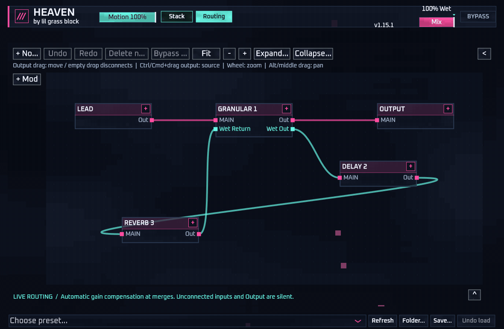
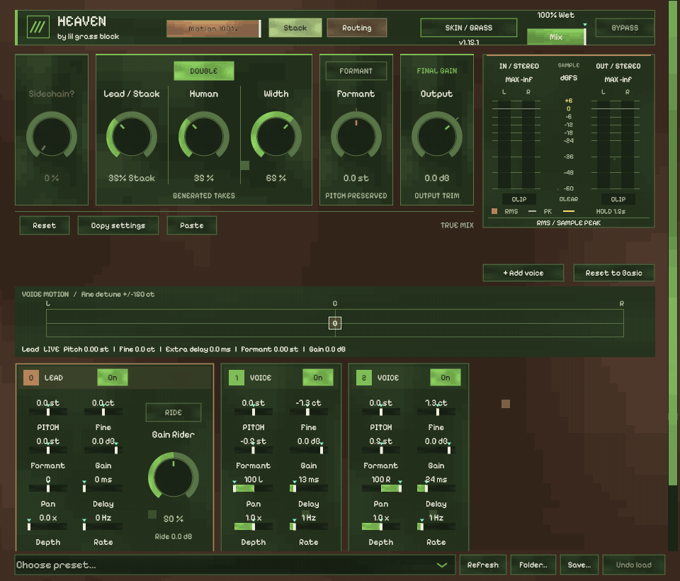

# HEAVEN by lil grass block

**The plugin might have critical bugs leading to severe performance losses.**

**Build a vocal stack. Split it into parallel effects. Or run just the delay.**

HEAVEN is an open-source audio effect for **Windows x64 · CLAP and VST3**. Turn one take into **up to eight generated voices plus an independent Lead**, shape each branch, and bring it all back together in a modular effects graph. Stack and Routing are two views of the same patch.

[Download the latest release](https://github.com/YukiYuziriha/plug1/releases/latest) · [Install](#download--install) · [First patch](#first-patch) · [Routing](#routing-in-neon) · [Grass Block](#grass-block-theme)

## Routing in Neon

*Neon Routing in v1.15.1, with visual motion set to 100%.*

**Echo the grains, not the vocal.** A wet pocket lets you build an effects chain inside an effect without sending its dry signal through that chain. In v1.15.1, the pocket is visible right on the Routing canvas: patch **Granular Wet Out → Delay → Reverb → Granular Wet Return**. Granular’s ordinary output stays connected, and its **Mix** blends the entire wet chain with its untouched dry path.

Wet paths can branch into parallel effects, too. Drop a disconnected node onto a highlighted cable to splice it in; one Undo restores the original cable and node position. [Patch your first wet path](docs/Getting-Started.md#shape-only-the-wet-signal).

## Grass Block theme

Grass Block gives Stack pixel lettering and blocky textures without changing how the patch sounds. Use **Skin** to cycle between Device, Neon, Spectral and Grass Block. New instances start in Neon; saved patches retain their skin.

[Browse earlier effect demos and capture notes](docs/showcase/README.md).

## What you can make

- **Doubles and layered harmonies.** Shape pitch, fine detune, formant, gain, pan, delay and motion per generated voice, with independent Lead edits. Start clean or pick from [30 factory presets](docs/Factory-Presets.md).
- **Parallel and multiband effects.** Give voices their own FX, split signals into two or three bands, and recombine branches with Dry/Wet mixers. Main Bus FX tabs edit the same nodes as Routing.
- **Spectral crossbreeds.** Blend a donor’s spectrum into your vocal with Spectral Morph’s **MAIN** and **DONOR** inputs, Magnitude and Envelope modes, and donor Freeze. Feed it an internal branch or the raw mono/stereo host sidechain, independent of the Sidechain card.
- **Recorded doubles.** [Blend a host sidechain into the Lead](docs/Getting-Started.md#blend-a-recorded-double-with-sidechain), raw or shaped independently with the Sidechain card.
- **Glitch fills and evolving patches.** Grab a phrase and fire reverses or ratchets with MIDI-triggerable Vocal Glitch. Modulate supported controls with LFO or Random and save the whole patch as a preset.

## Download & install

Get the **Windows x64 ZIP**, **SHA256 checksums**, and **corresponding source** from the [latest GitHub release](https://github.com/YukiYuziriha/plug1/releases/latest). Extract the ZIP and install just the format your host supports:

| Format | What to copy | Install location |
| --- | --- | --- |
| CLAP | `HEAVEN by lil grass block.clap` | `%LOCALAPPDATA%\Programs\Common\CLAP\` or `C:\Program Files\Common Files\CLAP\` |
| VST3 | The **entire** `HEAVEN by lil grass block.vst3` folder, including `Contents` | `%LOCALAPPDATA%\Programs\Common\VST3\` or `C:\Program Files\Common Files\VST3\` |

Close hosts that have HEAVEN loaded before replacing it. Add the install location to your host’s scan paths if needed, rescan, and insert **HEAVEN by lil grass block** as an audio effect. Keep the included license files, source notice, font licenses and third-party notices with your copy. No macOS, Linux or standalone binaries are supplied.

## First patch

1. Insert HEAVEN on a vocal track. Turn on **Doubler**, dial in **Human** and **Width**, then balance the Lead against the generated voices with **Lead / Stack**.
2. Select a voice card to edit it, or use **+ Add voice** to expand the stack.
3. Use **+ FX** for main-bus effects, or open **Routing** to build per-voice, multiband or sidechain paths.
4. Set **Global Mix** to blend the original input with the whole patch, trim **Output**, and save a preset.

[Getting Started](docs/Getting-Started.md) · [Build from source](docs/Building.md) · [Report an issue](https://github.com/YukiYuziriha/plug1/issues)

## License & credits

Open source under **GPLv3 + AGPLv3**: project-owned code retains [GPLv3](LICENSE), with JUCE used under its [AGPLv3](COPYING.AGPLv3) option. See [licensing and corresponding source](docs/Licensing.md) for combined-work and redistribution terms, and [historical source downloads](docs/Historical-Source.md) for older releases.

[Third-party notices](ThirdParty) cover JUCE, CLAP/CLAP JUCE Extensions, the VST3 SDK, Signalsmith Stretch/Linear, the GPL-covered [Vital filter subset](ThirdParty/Vital/README.md), and [Pixelify Sans](ThirdParty/PixelifySans-OFL.txt) and [Oxanium](ThirdParty/Oxanium-OFL.txt) under the SIL Open Font License 1.1. Embedded dependency notices also apply. Convolution uses original synthetic Church, Hall, Room and Plate IRs.
