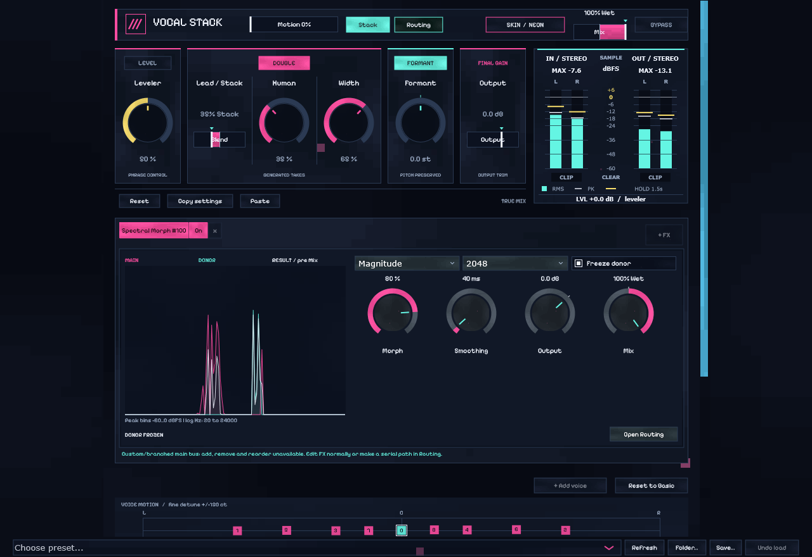
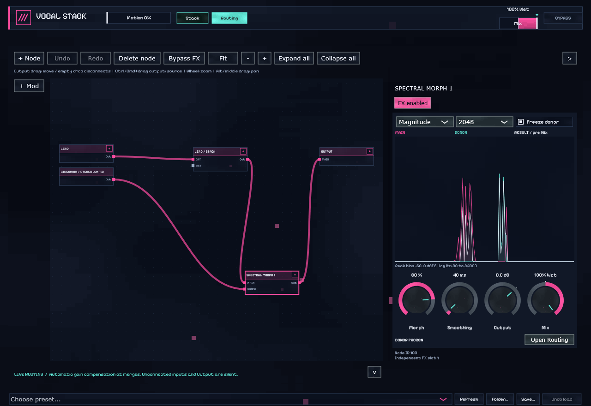

# Vocal Stack

**Build a vocal stack. Shape each voice. Route the result your way.**

Vocal Stack is a Windows x64 audio effect in **CLAP and VST3** formats. Start with
vocal doubling, expand to **eight generated voices plus a separate Lead**, then
shape individual branches or the whole mix with a modular effects graph. Stack
and Routing are two views of the same patch—not separate processing modes.

**v1.11.0** · [Download & install](#download--install) ·
[Getting Started](docs/Getting-Started.md) · [Showcase](#showcase) ·
[Build from source](docs/Building.md) · [GPLv3 + AGPLv3 licensing](docs/Licensing.md)

*Current v1.11 Stack editor with Spectral Morph selected. This fixture emphasizes
the main controls and FX rack; voice cards are below the visible area.*

## What you can make

- **Doubles and layered harmonies.** Control pitch, fine detune, formant, gain,
  pan, delay and motion per generated voice, with independent Lead edits. This
  is transposition and doubling, not automatic pitch correction or scale detection.
- **A patch, not just an effects chain.** Route voices through independent FX,
  merge branches, add Dry/Wet mixers, duplicate a signal with Splitter, or divide
  it into two/three frequency bands. Stack's Main Bus FX tabs edit the same nodes
  as Routing.
- **Two-source spectral processing.** Spectral Morph has separate **MAIN** and
  **DONOR** inputs, Magnitude/Envelope modes and donor Freeze. Use an internal
  branch or an explicitly wired optional mono/stereo host sidechain as the donor.
- **Tone, space and texture.** EQ8, Waveshaper, Chorale, Delay, Reverb, synthetic-IR
  Convolution, Saturator, Compressor, Bitcrusher, Granular, Gain, Stereo,
  Gate/Expander, XP Filter and Synth Filter.
- **Movement and recall.** LFO/Random modulation, full-patch presets, shared
  routing Undo/Redo and Device, Neon and Spectral themes. Input/output meters
  distinguish RMS and sample peaks; selected FX expose measured histories or spectra.

## Showcase

### Spectral Morph — choose a donor, then hold its spectrum

Independent MAIN/DONOR/result spectra show the analysis before Mix and Output.
Freeze captures donor spectral data while MAIN continues; it does not record an
audio loop. Adding Morph does **not** create a donor connection for you.

### Reverb — see the wet tail, not just a decay setting

The measured input/wet field responds to processed audio. The thin decay and
swell guides describe settings; they are not a measured impulse response.

### Compressor — inspect the attenuation actually applied

A four-second measured gain-reduction history sits above the static transfer
curve, keeping actual attenuation separate from the parameter model.

### Stereo — check width and mono compatibility

Width, balance, channel swap and polarity controls share a rack with L/R activity,
correlation and a persisted post-Mix Mono Audition switch.

*These compact clips use real generated PCM through production DSP and component
frames, not screen recordings or vocal listening demos. They do not establish
native UI FPS or DAW compatibility. [Media notes and provenance](docs/showcase/README.md).*

### Routing — make the two-source connection explicit

This current fixture connects the Lead/main-mix path to **MAIN** and SIDECHAIN to
**DONOR**. A `STEREO CONFIG` label describes the host bus configuration—not proof
that a host track is connected. [Follow the wiring walkthrough](docs/Getting-Started.md#spectral-morph-and-sidechain).

## Download & install

Download the [**v1.11.0 Windows x64 ZIP**](https://github.com/YukiYuziriha/plug1/releases/download/v1.11.0/VocalStack-1.11.0-Windows-x64.zip)
for both formats, their complete notices and source-download information.
[SHA256 checksums](https://github.com/YukiYuziriha/plug1/releases/download/v1.11.0/SHA256SUMS.txt)
are supplied with the release. The same plugin bytes are also tracked below.

| Format | Download | Install |
| --- | --- | --- |
| CLAP | [Vocal Stack.clap](https://github.com/YukiYuziriha/plug1/raw/refs/heads/main/Windows-x64/CLAP/Vocal%20Stack.clap) | Copy the file to `%LOCALAPPDATA%\Programs\Common\CLAP\` or `C:\Program Files\Common Files\CLAP\`. |
| VST3 | [Vocal Stack.vst3 bundle](Windows-x64/VST3/Vocal%20Stack.vst3) | Copy the **entire folder**, including `Contents`, to `%LOCALAPPDATA%\Programs\Common\VST3\` or `C:\Program Files\Common Files\VST3\`. |

For VST3, download the repository with GitHub's **Code → Download ZIP** or clone
it, then take the bundle from `Windows-x64/VST3/`. The bundle link above browses
the folder; downloading only its inner binary is not a complete installation.
Keep the [GPLv3 text](Windows-x64/LICENSE.txt), [AGPLv3 text](Windows-x64/COPYING.AGPLv3),
[source notice](Windows-x64/SOURCE.md), [font license](Windows-x64/PixelifySans-OFL.txt)
and [third-party notices](Windows-x64/ThirdParty) with your copy.

**Corresponding source:** these binary bytes use
[commit `12534e87440ca33a41f12bde53956319bd06ebab`](https://github.com/YukiYuziriha/plug1/tree/12534e87440ca33a41f12bde53956319bd06ebab).
Download the [**complete corresponding-source ZIP**](https://github.com/YukiYuziriha/plug1/releases/download/v1.11.0/VocalStack-1.11.0-corresponding-source.zip),
including the full pinned dependency sources, patches, notices and build tools.
[Build instructions](docs/Building.md) and [exact dependency pins](docs/Licensing.md)
are included. For binaries from older commits, also download the
[**source-history ZIP**](https://github.com/YukiYuziriha/plug1/releases/download/v1.11.0/VocalStack-source-history.zip);
[restoration instructions and the per-commit matrix](docs/Historical-Source.md)
explain how it combines with the dependency sources in the current source ZIP.
These release URLs are the publication targets for tag `v1.11.0`; the maintainer
uploads the prepared assets before making the release/repository public.

Close hosts that have the plugin loaded before replacing it. Add the chosen
folder to your host's scan locations if needed, rescan, and insert **Vocal Stack**
as an audio effect. You only need the format your host supports.
[Detailed installation and first patch](docs/Getting-Started.md).

## First patch

1. Insert Vocal Stack on a vocal track. Start with **Leveler**, **Human** and
   **Width**, then balance the edited Lead against generated voices with **Lead / Stack**.
2. Select a voice card to edit it; use **+ Add voice** to expand up to eight.
   The Lead is separate. Use moderate pitch/formant offsets before trying extremes.
3. Add main-bus processing with **+ FX**. Open **Routing** for per-voice effects,
   branches, multiband paths or a Morph donor. It is the same set of FX instances.
4. Use **Global Mix** for untouched original input versus the complete processed
   patch, and **Output** to trim level. Save a full-patch preset when ready.

**Three different blends:** Lead / Stack balances the edited Lead and generated
voices; an FX Mix blends that effect's dry/wet signals; Global Mix blends the
latency-aligned original input and the entire patch. Output trim is not a limiter,
and Leveler is not a fixed loudness target.

## Compatibility & limitations

- **Delivered platform:** Windows x64, CLAP and VST3. No macOS/Linux binaries,
  standalone application or other plugin formats are supplied.
- **Validation, not a host endorsement:** automated CLAP/VST3 module checks cover
  mono/stereo main and auxiliary layouts at **44.1, 48 and 96 kHz**. Actual Bitwig
  listening, session workflow and keyboard transport remain unverified; there is
  no claim of a tested DAW compatibility list. Treat this as experimental software
  and audition it in your own sessions.
- **Latency:** without Morph, reported totals are **1344 samples at 44.1/48 kHz**
  and **2688 at 96 kHz**. A graph declaring Morph adds **4096 samples**, even if
  that node is bypassed or disconnected. Adding/removing it can show
  **RESTART PENDING**: deactivate/reactivate or reload the plugin to apply that
  topology. Merely stopping transport is not enough. Serial Morph paths exceeding
  the routing latency budget are rejected.
- **Custom routing:** unwired inputs receive silence. A branched/auxiliary patch
  can make rack add/remove/reorder unavailable; edit its topology in Routing.
  Existing FX parameters remain editable. Extreme pitch/formant shifts can produce
  source-dependent artifacts; no audio-quality or CPU/FPS guarantee is made.

The [v1.11.0 release record](docs/Release-1.11.0-Validation.md) distinguishes passing
DSP/module checks from the remaining native desktop-input/occlusion blocker.

## Documentation & support

- [Getting Started](docs/Getting-Started.md) — installation, voices, routing,
  sidechain, latency and troubleshooting.
- [Building](docs/Building.md) — prerequisites, pinned dependencies, CMake and tests.
- [Manual and history archive](docs/Manual-and-History.md) — preserved detailed
  controls, architecture and earlier release records; historical values are labeled.
- [v1.11.0 technical notes](docs/Preview-1.11.0.md) and
  [release validation](docs/Release-1.11.0-Validation.md) — implementation details
  and observed limitations. References to local build artifacts in these older
  records are not public downloads.
- [Report an issue](https://github.com/YukiYuziriha/plug1/issues) with the plugin
  version, Windows/host version, format, sample rate, block size and a small
  reproduction patch. Remove private audio and personal paths before sharing.

## License & credits

Vocal Stack selects **JUCE's open-source AGPLv3 route**. The CLAP/VST3 plugin is a
**combined GPLv3/AGPLv3 work** under section 13 of both licenses, not GPLv3-only.
Project-owned source keeps the existing [GPLv3 license](LICENSE); JUCE modules use
[AGPLv3](COPYING.AGPLv3). There is no claim of a commercial JUCE entitlement and no
blanket relicensing of third-party code. See [Licensing and corresponding source](docs/Licensing.md)
for the scope, distribution obligations and publication checklist.

[ThirdParty](ThirdParty) retains notices for JUCE, CLAP/CLAP JUCE Extensions, the
VST3 SDK, Signalsmith Stretch/Linear, the GPL-covered
[Vital filter subset](ThirdParty/Vital/README.md), and Pixelify Sans under the
[SIL Open Font License 1.1](ThirdParty/PixelifySans-OFL.txt). Embedded dependency
notices also remain applicable. Convolution uses original synthetic Church,
Hall, Room and Plate IRs, not third-party sampled spaces.
