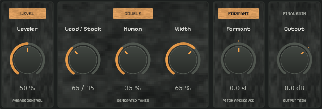
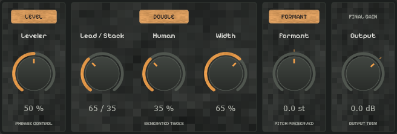
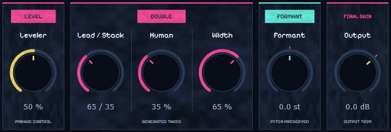
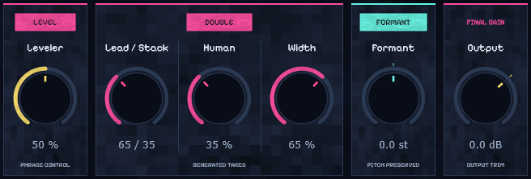
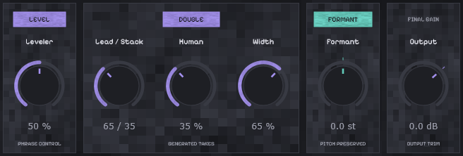

# Vocal Stack 1.9.9 validation

## Card-only texture change

`FluidBackground::paint` accepts an optional longest-edge texel count; the default
remains 80. Only the four `controlPlates` paint calls in `PluginEditor.cpp` opt into
24, in Device, Neon and Spectral. No noise equations, theme colours, contrast,
rare integrated glint seeds/envelopes, 1.2 animation-speed multiplier, typography,
geometry, keyboard focus, DSP, parameters or state were changed.

At native 1x editor scale (physical pixels multiply by display/editor scaling):

| Actual card | Bounds | Before grid | Before texel footprint | After grid | After texel footprint |
| --- | --- | --- | --- | --- | --- |
| Leveler, Formant, Output | 104 x 214 | 39 x 80 | 2.67 x 2.68 px | 12 x 24 | 8.67 x 8.92 px |
| Generated takes | 306 x 214 | 80 x 56 | 3.83 x 3.82 px | 24 x 17 | 12.75 x 12.59 px |

Nearest-neighbour rasterization gives integer runs of 2–3 -> 8–9 pixels for the
narrow cards and 3–4 -> 12–13 pixels for generated takes, rather than interpolated
fine noise. Aspect rounding is unchanged. Cache dimensions already invalidate a
surface when its grid changes.

## Deterministic coverage

- `FluidBackgroundTests.h` measures solid 10 x 10 rendered texel blocks at an exact
  240 x 120 test size, checks transitions land on the 10-pixel grid, and verifies
  that switching the same instance back to default restores the original image.
- Actual editor snapshots compare empty strips of all four real cards against
  the explicit 24-grid renderer in every theme, and require visible boundaries
  and differences from the original 80-grid texture. Initial test strips crossed
  knob/value artwork; the final strip is below the controls, above the captions.
- Existing tests retain deterministic phases, resize/default grid checks, muted
  contrast, sparse glints, 20%-faster motion, animated buttons, active state and
  passive keyboard focus.
- Additional machine-local screenshot comparison checked every pixel of all three
  full 1.9.8/1.9.9 captures: all four cards changed and every pixel outside their
  rectangles was identical. Local script: source/build/check-card-scope-199.ps1.
  An initial Python attempt could not import Pillow; the successful check uses
  built-in System.Drawing instead, without adding a dependency.

## Observed validation and delivery

- All configure/build/compiler/test commands used `tools/Invoke-HalfCpu.ps1` in
  dedicated 64-bit PowerShell: 6/12 logical processors, affinity 0x3F, 6 jobs.
- Initial Release build hit its 200-second bound; incremental resume succeeded.
  The existing local build helper then failed forwarding `--test-dir` to the
  wrapper, before CTest launched. Explicit `-CommandArguments` array invocation
  resolved that invocation issue without changing tracked tooling.
- Final successful incremental build: source/build/release-199-complete.log.
- Final full CTest: **35/35 passed, 216.65 seconds**, including VocalStackDSP and
  VocalStackEditor (119.51 seconds). No test exclusions. Log:
  source/build/tests-199-final.log. Earlier full run also passed 35/35.
- Focused Fluid pixel editor group passed independently through the wrapper;
  the final full run includes the added exact block-size/cache checks.
- Visually inspected full Device, Neon and Spectral before/after captures:
  clearly separated chunky card pixels, readable labels/values, no visible layout
  or control changes. Crops below retain native resolution.
- Refreshed tracked CLAP/VST3 from successful Release artifacts. Existing
  source/build/install-release.ps1 reported Installed and SHA256 verified for
  both per-user formats. No host was killed or forcibly unloaded.
- Packaged and installed CLAP smoke both passed through the half-CPU wrapper:
  2087 automatable parameters at original indices, state/bypass/automation/offline
  layouts; stereo 48 kHz and mono-to-stereo 44.1 kHz latency 1344 samples, mono
  96 kHz latency 2688. Logs: source/build/smoke-199-{package,installed}.log.
- No remaining build/test/install blocker. Actual Bitwig listening/transport and
  a separate VST3-host smoke were not performed; installation verification is not
  a listening test.

## Before / after screenshots

### Device

Before:

After:

### Neon

Before:

After:

### Spectral

Before:

After:

## Packaged SHA256

- CLAP: `ff59f73d196d67bae2bcd8666651309fcdfb1ff8b804ca49cf34606f3e620a16`
- VST3: `3df2e3874b8f0940d1544616cc74f121adf796937748dfc9859089afaf8fecaa`
